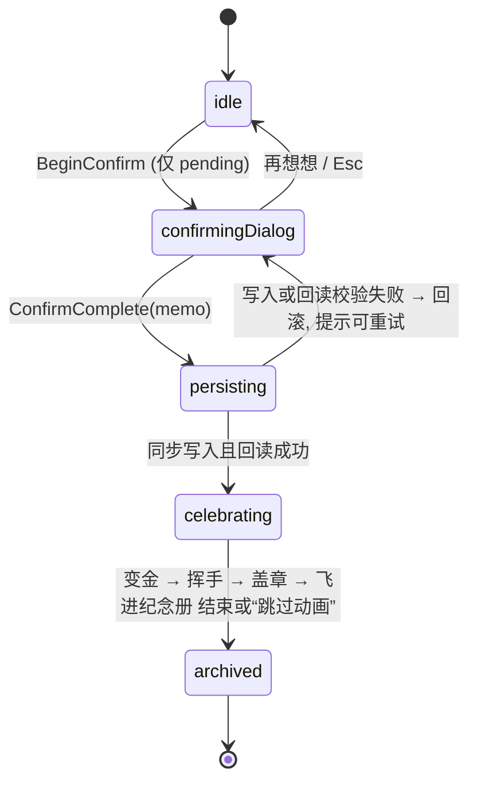
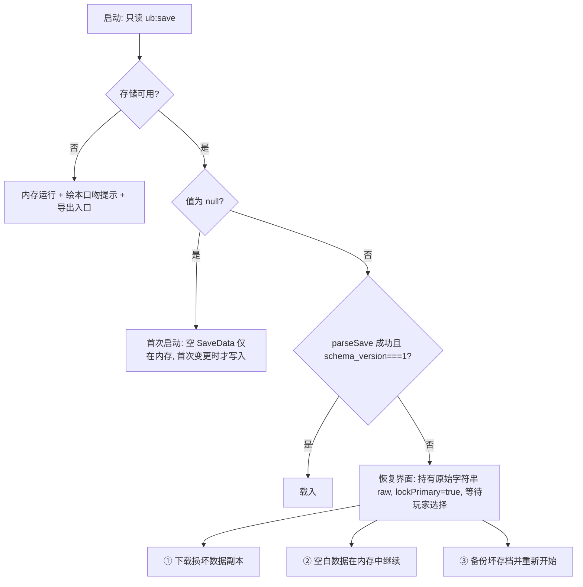
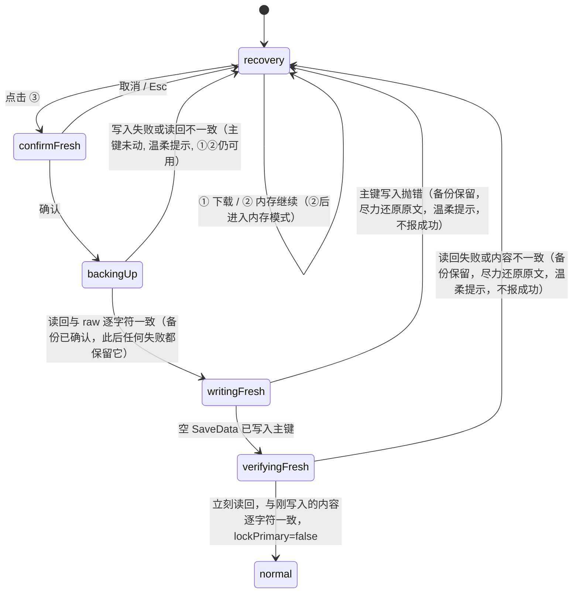

# 设计文档：Unfinished Business

**与 requirements.md 对齐版本：2026-11-07（共享楼层娃娃屋收口）**

## Overview

Unfinished Business 是纯前端静态单页应用：玩家创建 Task，一只 Ghost 搬进侧面剖面的旧宅；澄清条件、拆步骤、勾选家务，Ghost 自己的颜色与微光随进度变得饱满；玩家明确确认后 Ghost 变金、挥手、盖章、飞进纪念册，并在门厅点亮一件小暖灯。

旧宅的核心结构：

- 一楼固定为门厅与 Ghost_Archive；二至六楼是五个 Floor，每个 Floor 是**一间横向贯通的共享大房**，含左、右两个 Slot（各有一个 Home Anchor），每层最多两只 Resident，五层最多十只；两只 Resident 共享整层室内 Roam Area。
- 旧宅的 PNG 永远是**静态布景（Static_Layer）**，不随任何 Task 的进度变色或变亮。Ghost、个人光晕、金牌、动画、点击区、任务卡都是叠在其上的**独立动态层（Dynamic_Layer）**。
- 玩家点击的是**Ghost 本人**，不是房间；楼层、家具、墙面与空 Slot 不可点击。

### 术语对照（设计内一致使用）

| 需求术语 | 设计中的用法 |
|---|---|
| Floor | 二至六楼，`floor ∈ 2..6`；楼层没有“房间”概念 |
| Slot | `SlotId = { floor, slot }`，`slot` 0=左、1=右；代码中不使用 room 一词 |
| 静态楼层模块 | 素材包里的 `floor-01`…`floor-05`，依次对应**玩家看到的二楼…六楼**：`moduleIdForFloor(f) = floor-0(f−1)` |
| Static_Layer / Dynamic_Layer | 屋顶、门厅、楼层模块 PNG / 其上的一切交互与动画 |
| Warm_Lamp | 动态小暖灯或小装饰，`lampsFor(completedCount) = min(12, completedCount)` |

### 技术选型

| 项 | 选择 | 理由 |
|---|---|---|
| 构建 | Vite + TypeScript，`base: './'` | 产物仅 HTML/CSS/JS，相对路径 |
| 视图 | Preact（组件化） | 体积约 4KB，组件化便于 House/Ghost/Dialog 复用；JSX 默认转义文本，天然满足“Task 文本只作纯文本”（Req 1.3）；团队已确认 |
| 测试 | Vitest + fast-check + @testing-library/preact + happy-dom；真实浏览器 E2E 用 Playwright | domain 与 house 纯函数做属性测试，组件做行为测试；`e2e/` 用 Playwright 跑 Chromium |

视图方案对比：

| 方案 | 优点 | 缺点 | 结论 |
|---|---|---|---|
| Preact | 体积小、组件化、生态成熟、与 React 写法一致 | 多一个运行时依赖 | **选用** |
| 无框架（手写渲染助手） | 零依赖 | 对话框、列表、焦点管理要自写 diff，易出错 | 不选 |
| React | 生态最大 | 体积约 10 倍于 Preact，本项目用不到其高级特性 | 不选 |

**依赖清单**：运行时依赖仅 `preact`。开发依赖：`vite`、`@preact/preset-vite`、`typescript`、`vitest`、`fast-check`、`@testing-library/preact`、`happy-dom`、`@playwright/test`。版本号用精确值锁定；不使用 `@preact/signals`、不使用 `preact/compat`（减少依赖面）。旧宅分层、镜头、避让全部用原生 CSS、WAAPI 与纯函数实现，不引入动画库或图形库。

**安全约束**：所有 Task_Title、Completion_Criteria、Step 标题、留言只通过 JSX 文本节点或属性渲染；源码安全由 Vitest 源码扫描（`tests/source-safety.test.ts`）强制：禁止 `innerHTML`、`outerHTML`、`insertAdjacentHTML`、`dangerouslySetInnerHTML`；禁止 `fetch`、`XMLHttpRequest`、`sendBeacon` 与外部 URL（SVG 命名空间除外）；纯模块禁止引用 DOM 全局与 Preact。URL 仅允许固定 hash（`#/`、`#/archive`），Task 文本不写入 URL、title 或 history，且 hash 不在界面显示。

## Architecture

### 分层与模块

```mermaid
flowchart LR
  UI[components: Preact 组件] -->|dispatch Action| Store
  UI -->|UI Action: 选中/镜头| Ui[ui store: 选中与镜头, 不持久化]
  subgraph core[无 DOM、无 Preact 的纯模块]
    Reducer[domain: reducer + evaluate + slots]
    HouseCore[house: layout + anchors + motion + paint + viewport + order]
    Parser[persistence: serialize/parse/recovery]
    Copy[i18n: Copy_Resource]
    Events[animation: 事件类型与调度计划]
  end
  Store[store: 极简订阅式] --> Reducer
  Reducer -->|state + events| Store
  Store --> Persist[persistence adapter: localStorage / memory]
  Store -->|useStore 订阅| UI
  Store -->|AnimEvent[]| Anim[animation player: WAAPI/CSS]
  UI --> HouseCore
  Anim --> HouseCore
  Parser --- Persist
  Copy --- UI
```

数据流单向：`Action → reduce(state, action, env) → {state, events} → persist + 通知订阅者重渲染 + 动画播放`。`env = {now, newId}` 由外壳注入，reducer 不读时钟、不生成随机数。选中哪只 Ghost、镜头是否为全景属于界面状态，放在独立的 ui store，不进入 Save_Data，也不经过 domain reducer。

### 状态绑定方案

采用 **自写极简 store + Preact hooks**（二选一的结论：不用 signals）。理由：状态是一棵由 reducer 产生的不可变树，整体订阅 + 选择器已够用；少一个依赖，domain 层保持框架无关。

```ts
interface Store { getState(): AppState; dispatch(a: Action): void; subscribe(fn: () => void): () => void }
function useStore<T>(store: Store, select: (s: AppState) => T): T  // useState + useEffect 订阅，选择器结果引用不变则不重渲染
```

### 目录结构

```
src/
  domain/      types.ts evaluate.ts progress.ts reducer.ts slots.ts house.ts validate.ts
  house/       layout.ts(静态模块堆叠) anchors.ts(Home Anchor、可导航区、障碍矩形与动作位) lobby.ts(门厅锚点与暖灯位)
               motion.ts(双住客活动与避让) paint.ts(进度外观) viewport.ts(布局与镜头；抽屉露出算法在 components/revealAboveDrawer.ts) order.ts(聚焦顺序)
               data/ (随素材纳入的 room-layout 与 atlas 精简数据)
  assets/house/  静态旧宅 PNG：roof、lobby、floor-01…floor-05，各含 1x 与 2x（实现阶段接入）
  persistence/ serialize.ts parse.ts storage.ts(adapter) keys.ts recovery.ts
  i18n/        copy.ts(Copy_Resource) en.ts zh-CN.ts t.ts
  animation/   events.ts plan.ts player.ts reducedMotion.ts
  store/       store.ts useStore.ts StoreContext.tsx uiStore.ts
  components/  App.tsx Stage.tsx Sky.tsx House.tsx StaticLayer.tsx FloorView.tsx GhostButton.tsx GhostSprite.tsx
               Lobby.tsx WarmLamps.tsx CelebrationLayer.tsx TaskCard.tsx ConfirmDialog.tsx Archive.tsx
               Recovery.tsx FullHouseNotice.tsx Dialog.tsx LiveRegion.tsx
  main.tsx
tests/         *.test.ts  *.prop.test.ts  components/*.test.tsx
```

约束：`domain/ house/ persistence/ i18n/ animation/(events,plan)` 禁止引用 `document`、`window` 与 `preact`，由上述 Vitest 源码安全扫描保证。`animation/` 中仅 `player.ts` 可以引用 DOM。随机数一律由调用方注入的 `rand: () => number` 提供，保证测试可复现。

## Components and Interfaces

```ts
type GhostState = 'gray' | 'white' | 'green' | 'gold';
evaluate(task: Task): GhostState            // 纯函数，不读时间
progress(task: Task): { done: number; total: number; ratio: number } // total=0 → ratio 0
isPendingConfirmation(task: Task): boolean  // 未确认 && total>0 && done===total
choreFor(stepIndex: number): 'sweep' | 'water' | 'window' // index % 3

reduce(s: AppState, a: Action, env: Env): { state: AppState; events: AnimEvent[]; error?: UserError }
allocate(occupied: ReadonlySet<string> /* slotKey */): SlotId | null   // 楼层升序、左先右后
floorsNeeded(residentCount: number): 2|3|4|5|6
lampsFor(completedCount: number): number                                // min(12, n)
residentOrder(tasks: readonly Task[]): Task[]                           // 楼层从上到下、同层从左到右
ghostPaint(state: GhostState, ratio: number, pending: boolean): Paint   // 见“进度表达”
layoutHouse(grownFloors: 2..6): HouseLayout                             // 静态模块堆叠
planMove(floor: FloorSpace, self: Actor, other: Actor | null, goal: Goal, rand): MoveResult  // 见“活动规则”
planMeet(floor: FloorSpace, a: Actor, b: Actor, spot: ActionSpot): MeetResult   // 双方路径与终点一次性校验
computeViewLayout(input: ViewInput): ViewLayout                         // 见“布局与镜头”
parseSave(raw: string): Result<SaveData, ParseError>   // 绝不抛异常
serializeSave(d: SaveData): string
t(key: CopyKey, lang: Lang): string
```

domain Action：`CreateTask / SetCriteria / AddStep / EditStep / DeleteStep / MoveStep / ToggleStep / BeginConfirm / CancelConfirm / ConfirmComplete(memo) / DeleteTask / ToggleTitleVisible / SetLang / EnterDemo / ExitDemo`。被拒绝的 Action 返回 `error` 且 state 引用不变。

UI Action（ui store，不持久化、不产生 domain 事件）：`SelectGhost(taskId) / CloseCard / FocusFloor(floor) / EnterPanorama / ExitPanorama`。

## Data Models

```ts
type ISO = string;                       // ISO 8601 UTC
interface Step { id: string; title: string /*1–80*/; done: boolean }
interface SlotId { floor: 2|3|4|5|6; slot: 0|1 }   // 0=左, 1=右
interface Task {
  id: string; ghostNo: number;           // 仅内部排序用，单调递增，不复用，绝不显示给玩家
  title: string /*1–80*/; criteria: string /*0–200*/;
  steps: Step[] /*≤50*/;
  slot: SlotId;                          // 确认/删除即从占用集合移除
  createdAt: ISO;
}
interface MemorialEntry {
  id: string; title: string; titleVisible: boolean;  // 默认 false，持久化
  completedOn: string;                   // 本地时区 YYYY-MM-DD，确认时由 env 计算后存入
  stepCount: number; memo: string /*0–140*/; confirmedAt: ISO;
}
interface Settings { lang: 'en' | 'zh-CN' }
interface HouseState { grownFloors: 2|3|4|5|6; completedCount: number /*累计确认完成数，≥0*/ }
interface SaveData {
  schema_version: 1;                     // 仅作标识
  tasks: Task[];                         // 仅未确认 Task
  archive: MemorialEntry[];              // 展示按 confirmedAt 降序
  house: HouseState; settings: Settings; nextGhostNo: number;
}
interface UiState {                      // 不持久化
  selectedTaskId: string | null;
  camera: 'focus' | 'panorama';          // 仅 <900px 有意义
  focusFloor: 2|3|4|5|6 | null;
  primedTaskId: string | null;           // 全景中被点击、已聚焦楼层、等待“再次点击”的 Ghost
}
```

- Confirmed_Task 在确认时从 `tasks` 移入 `archive`，因此“已确认不占 Slot”（Req 1.7）由数据结构保证；Confirmed 的“禁止编辑”（Req 2.7）在 reducer 对不存在于 `tasks` 的 id 一律拒绝。
- 字符长度按去首尾空白后的 Unicode 码点（`[...s].length`）计算；Task_Title/Step 标题先 trim 再校验；criteria 与 memo 不强制 trim，但以去空白后长度判 Clarified。
- `completedCount` 对应 Req 9.2 的“完成计数”，每次确认成功 +1，删除 Task 不影响它；MVP 不提供删除纪念册条目，故恒有 `completedCount === archive.length`（Parser 校验）。Warm_Lamp 数量不另存，由 `lampsFor(completedCount)` 派生，因此永不减少、不依赖时间、删除未完成 Task 不增加。
- ID 来自 `crypto.randomUUID()`（不可用时回退计数器+随机串），仅由外壳 `env.newId` 提供。

### Ghost 的玩家可见称呼

玩家界面**不显示** `ghostNo`、`id`、哈希或任何内部编号。称呼按“位置”生成：住客列表与可访问名称用“住在二楼左边的小幽灵 / The little ghost on floor 2, left”；纪念册条目用“一只小幽灵，在 2026-11-07 圆满 / A little ghost, complete on 2026-11-07”。位置称呼来自 `SlotId`（slot 0=左，1=右），随住客位变化是可接受的；Ghost 不命名（Post-MVP）。

## 状态机

### Ghost_State 判定

| confirmed | Clarified | done | 结果 |
|---|---|---|---|
| 是 | - | - | gold（只出现在庆祝序列与纪念册） |
| 否 | 否 | - | gray |
| 否 | 是 | 0 | white |
| 否 | 是 | ≥1 | green |

Pending_Confirmation 是派生标志，不是第五状态，且以 Clarified 为前提（`isClarified(task) && total>0 && done===total`）：完成条件为空而步骤全勾时保持 gray / Not clear yet，不显示金边、金牌、Ready to confirm 与确认按钮，BeginConfirm/ConfirmComplete 返回 not-pending；详情卡改提示“One last thing: what does done look like?”，Ghost 用 puzzled 眼神；保存完成条件后立即变 green + Pending。Ghost_State 仍为 green，叠加“等你确认 / Ready to confirm”标签、细金光（或小金牌）与“确认完成”按钮。删除 Step 导致 total 变化时由 `evaluate` 重新计算。

### 确认完成流程



- `persisting` 同步：内存计算新 state → `storage.write` → 立即 `read` 比对；成功才提交并产出事件，失败丢弃新 state、不发事件（Req 5.3）。
- 提交成功时，Task 已移入 `archive`、Slot 已腾空、`completedCount` 已 +1；随后 ui store 清除选中（详情抽屉关闭，页面底部留白随之收回），视觉上由庆祝层继续演出，不依赖数据里的 Slot。
- 重复触发保护：flow 不在 `confirmingDialog` 时 `ConfirmComplete` 被忽略；`celebrating` 期间相关按钮禁用；task id 已不在 `tasks` 时再次确认被拒。
- 刷新恢复：`persisting` 成功时已落盘，刷新后直接渲染最终状态（Req 5.6）。
- **庆祝序列时长预算（Req 5.2、5.7）**，顺序与需求一致：变金 1.0s + 挥手 0.9s + 在 Memorial_Entry 盖章 0.9s + 飞进 Archive_Book 1.8s（暖灯在飞行最后 0.5s 内点亮，与飞行重叠，不另占时长）= 4.6s ≤ 5s；“跳过动画”随时调用 `player.finishAll()`。
- 盖章时出现在 Ghost 身旁的纪念页**只显示 Stamp（日期、步数、“已圆满 / Complete”）与留言，不显示 Task_Title**，与纪念册默认隐藏标题一致。
- 庆祝期间若玩家创建新 Task 且分到刚腾出的 Slot，新 Ghost 的入住动画等庆祝 Ghost 飞离该楼层（飞行开始后约 0.5s）再播放，避免两只同时出现在同一 Home Anchor。

## 住客位承载与分配

```
roof    ← 随楼层增长上移
floor 6: [左][右]   ← 第 9 只入住时长出（静态模块 floor-05）
floor 5: [左][右]   ← 第 7 只（floor-04）
floor 4: [左][右]   ← 第 5 只（floor-03）
floor 3: [左][右]   ← 第 3 只（floor-02）
floor 2: [左][右]   ← 第 1、2 只（floor-01）
floor 1: 门厅 + Ghost_Archive（lobby，固定，无 Slot）
```

- 每层是一间共享大房：无墙、无分割线、无围栏，左右两个 Slot 只是创建时分配的两个 Home Anchor（入住、休息、Reduced Motion 的静止位置），不是活动笼子；整层室内是两只 Resident 共享的 Roam Area（见“Slot 坐标、活动与避让”）。
- `allocate`：floor 升序、slot 0→1，返回第一个空 Slot；占用数 10 返回 `null`。
- 首页只渲染已长出的楼层：`<House grownFloors={house.grownFloors}>`，门厅、暖灯、住客与庆祝层同用这一个值；校准页可强制显示六层。
- 楼层增长：`floorsNeeded(n) = 2 + ceil(max(n−2, 0)/2)`，即占用数 3、5、7、9 时分别需要 3、4、5、6 层。入住后 `grownFloors = max(grownFloors, floorsNeeded(占用数))`，**显式存于 `house.grownFloors` 并持久化**，只升不降；增加时发 `FloorGrown{floor}`。
- 不变量：最低优先填充保证 Slot 所在楼层 ≤ `grownFloors`。推导：占用数为 k（0 起）时新 Ghost 至多落在第 `2 + floor(k/2)` 层，而 `floorsNeeded(k+1)` 在 k=0..9 时恒不小于该值。
- 一只离开（确认或删除）**只腾出自己的 Slot**，同层室友位置与状态不变；被腾出的 Slot 立即可被下一次 `allocate` 返回，已长出的 Floor 不塌回。
- 满员：`CreateTask` 返回 `error: 'house-full'`，state 不变、不排队；界面保留输入草稿并弹出满员提示（文案见 i18n 与文案规范）。
- Warm_Lamp：每次确认 `completedCount += 1`；当 `lampsFor` 的结果增加时发 `WarmLampAdded{n}`；删除不触碰。

## 静态旧宅与动态层

### 分层

| 层 | 内容 | 交互 | 随进度变化 |
|---|---|---|---|
| Sky（页面背景） | 夜空、月亮、远树、萤火，原创 SVG/CSS | 无，`aria-hidden` | 否 |
| Static_Layer | roof、floor 模块、lobby 的 PNG（``，`pointer-events:none`，`draggable=false`） | 无 | **永不**（不加滤镜、不换图、不改透明度） |
| Dynamic_Layer（楼层） | 每个 Floor 一层：个人光晕、Ghost、金牌、步数标签、Ghost 按钮 | 仅 Ghost 按钮 | 仅 Ghost 自身 |
| Dynamic_Layer（门厅） | Archive_Book 按钮、Warm_Lamp | 仅 Archive_Book | 暖灯随完成数增加 |
| Dynamic_Layer（庆祝） | 飞行 Ghost 副本、纪念页 | 无，`pointer-events:none` | 仅庆祝期间 |
| 任务卡 / 对话框 | 详情、确认 | 是 | - |

`StaticLayer` 组件的入参**只有 `grownFloors`**（类型层面保证它读不到任何 Task 数据），因此 Req 6.9 由类型与测试共同保证。点击楼层空白处、家具、墙面与空 Slot 不触发任何选择：Static_Layer 不接收指针事件，Dynamic_Layer 里只有 Ghost 按钮与 Archive_Book 按钮可点。

### 模块堆叠与拼接

素材 atlas 给出每个模块的逻辑尺寸、`topJoin`、`bottomJoin`，堆叠规则为“上方模块的 `bottomJoin` 对齐下方模块的 `topJoin`，下方先画、上方后画”。逻辑宽度统一为 801。以门厅顶边为原点（y=0，向上为负），自下而上累加：

```
y(floor-0k) = y(下方模块) + topJoin(下方模块) − bottomJoin(floor-0k)       // 下方模块：k=1 时为 lobby
y(roof)     = y(最顶楼层) + topJoin(最顶楼层) − bottomJoin(roof)
舞台高度    = lobby.h − y(roof)                                              // roof 顶边为舞台顶
```

按当前素材数据算得的偏移（逻辑像素，供实现与测试核对，**以公式为准**）：

| 模块（玩家看到的楼层） | topJoin | bottomJoin | y |
|---|---|---|---:|
| lobby（一楼） | 6 | 277 | 0 |
| floor-01（二楼） | 3 | 284 | −278 |
| floor-02（三楼） | 3 | 282 | −557 |
| floor-03（四楼） | 3 | 280 | −834 |
| floor-04（五楼） | 3 | 281 | −1112 |
| floor-05（六楼） | 2 | 285 | −1394 |

屋顶 `bottomJoin=256`：两层时 `y(roof)=−531`（舞台高 813），三层 −810（1092），四层 −1087（1369），五层 −1365（1647），六层 −1648（1930）。

- **长楼只插入静态楼层模块并移动屋顶**：增长时只新增最顶部的一个 floor 模块，已有模块与门厅的相对位置不变；屋顶以 CSS `transform: translateY` 从旧位置过渡到新位置（≤1s），新模块用透明度加自下而上的 `clip-path` 揭开，营造“顶起屋顶”。Reduced_Motion 下直接显示最终布局。
- 舞台底边固定在门厅底部，增长向上延伸；增长后镜头按当前模式（见“布局与镜头”）保证新 Floor 或当前聚焦 Floor 在可视范围内。
- **轻微确定性错位**：每个模块按 id 取固定水平偏移 `dx`（逻辑像素）：floor-01 0、floor-02 +3、floor-03 −3、floor-04 +4、floor-05 −2、lobby 0，roof 与最顶楼层相同。约束：`|dx| ≤ 4`，相邻模块 `|dx 差| ≤ 8`，不随状态、时间或随机变化；每个 Floor 的动态层与其模块同盒子、同偏移，因此 Ghost 落点跟随模块一起错位。舞台左右各留出 `4/801` 的内边距容纳错位，不产生水平溢出。上述数值是初值，目视拼接处后允许在约束范围内微调。
- 拼接连续性由公式保证（相邻模块 join 线 y 重合）；`layoutHouse` 对 `grownFloors=2..6` 的每个结果都由测试核对 join 对齐与 `dx` 约束。

### 素材加载

- 只使用每个模块各自的 PNG（`` 标注 `width/height` 防止布局跳动），atlas 合图不进入运行时；`room-layout` 与 `atlas` 中用到的尺寸、join、wallAnchorsX、Home Anchor、可导航区、障碍矩形与动作位数值精简后存入 `src/house/data/`，与素材一起纳入项目。
- **优先 2× 素材并按显示尺寸选版本**：用宽度描述符，`srcset="<1x> 801w, <2x> 1602w"` 配合 `sizes="<当前舞台宽度>px"`，由浏览器依据显示宽度与设备像素比选择；舞台宽度变化时同步更新 `sizes`。roof 与 lobby 的 1x/2x 同理。
- **离线可用（Req 12.4）**：首屏渲染后，空闲时（`requestIdleCallback`，不支持时短定时器）把尚未长出的 floor 模块依次预加载（创建同样 `srcset/sizes` 的 `Image` 对象，`sizes` 与静态层共用 `FLOOR_IMAGE_SIZES`），`Image` 对象由旧宅持有到卸载，保证页面加载后离线时仍能长出新楼层。不使用 Service Worker。
  - **离线前需要完成的状态**：`.house[data-floor-preload]` 为 `ready`，表示所有未来楼层（挂载时尚未长出的）都已取到；`loading` 为还在取；`partial` 为有图片没取到，长出那层时用纯色底板顶替，不弹提示。界面不显示此状态；它是给自动测试读的，也是“页面加载后”的精确含义：玩家加载页面并停留到空闲预载结束，之后断网才有此保证。
  - **边界**：只预载挂载时选中的那个 srcset 候选；离线前若窗口宽度或设备像素比改变到另一档（如 2× 屏把窗口缩到约 424 CSS px 以下），新候选没有被取过，离线长出的那层会退成纯色底板。每个组件实例只跑一轮，不随楼层增长重来。
- 加载失败：该模块的盒子用纯色底板顶替，Dynamic_Layer 照常工作，Ghost 仍可点击；不弹技术性提示。
- 不修改任何 PNG 内容，不在运行时对图片做滤镜或着色。

## Slot 坐标、活动与避让

### 坐标系

所有坐标以**单张 801px 宽的 1× 楼层 PNG** 为基准，包含两侧透明边；原点在该 PNG 左上，向右、向下为正；Ghost 锚点取**身体底边中点**。舞台显示宽度为 W 时，位置与尺寸一律乘 `W / 801`（2× 素材的原图像素坐标乘 2，但运行时只用逻辑坐标）。动态层用百分比定位（`left = x/801`、`top = y/模块高`），Ghost 容器宽 `140/801`、锚点在容器底边中点，这样缩放时不需要 JS 重算，文字标签也不会随画面缩小。

### 房间空间模型（共享 Roam Area）

每个 Floor 的空间数据（`house/data/` 中的 `FloorSpace`，坐标同上，逻辑像素）包含四类内容，全部数据化，可被校准层画出、被测试读取：

| 数据 | 含义 |
|---|---|
| `navigable` | Room Navigable Rect（或 Polygon）：整层室内可用空间，即墙体、地板、天花板围出的区域。Ghost 连同道具的 envelope 必须完全在内 |
| `obstacles` | Obstacle Rects：仅包含由代码明确声明的互动家具或姿势道具障碍与预留矩形；Static_Layer 背景图案不自动成为障碍 |
| `homes` | 左/右 Home Anchor（Slot 0/1）。创建 Slot 时分配；入住、休息、Reduced Motion 的静止位置 |
| `actionSpots` | Action Spots：家务位（扫地、浇花、擦窗）、打招呼位、一起做家务位；每个含位置、姿态与自身的预留矩形 |

- **整层共享**：`navigable` 覆盖整层室内，包括窗边、床边、房间中央与半空。两只 Ghost 都可以去其中任何位置，允许经过对方的 Home Anchor 一侧，也允许在途中换位；不存在“左边属于左、右边属于右”的规则。
- **Home Anchor 不是活动笼子**：Home Anchor 只是静止/返回位置。数据中的 `homes` 带一个出生/静止参考范围（见下表，即 `room-layout.json` 的 left/right safe 小框），只用于入住落点与静止时的微小浮动，**不是完整活动范围**，校准层中标为 home / rest zone。
- **唯一约束**只有三条（由 `navigable`、显式 `obstacles`、envelope 共同决定，见“活动规则”）：不出界；两只不重叠；不与显式障碍重叠。Static_Layer 里的床、窗、椅子、花盆等只是背景，Ghost 可以飘在它们前面。
- **可扩展**：MVP 的 `obstacles` 可以为空。以后真正加入可互动家具或姿势道具时，只为那件对象增加/更新 `obstacles` 与 `actionSpots`，不缩回固定小框，不改规则。
- **数据来源**：由 Kiro 从 `room-layout.json` 与实际 PNG 派生 `navigable` 和 Home Anchor（`room-layout.json` 现有的 left/right safe 小框降级为 Home Anchor 附近的参考）；显式 `obstacles` 只来自产品代码中真实存在的互动对象，不从静态背景图案臆造。`navigable` 派生不出时，该层状态为 `missing`，该层 Ghost 只停在 Home Anchor、不漫游，不得写估算值。

### Home Anchor 与出生/静止参考范围（逻辑像素）

| 楼层 · 模块 · 家具 | 模块尺寸 | 左 Home Anchor | 左参考 x 范围 | 右 Home Anchor | 右参考 x 范围 | 参考 y 范围（两位相同） | meetY |
|---|---|---|---|---|---|---|---:|
| 二楼 · floor-01 · 小床与圆凳 | 801×287 | (292, 254) | 244–438 | (532, 254) | 363–606 | 208–260 | 254 |
| 三楼 · floor-02 · 书架与扶手椅 | 801×284 | (272, 254) | 204–438 | (524, 254) | 363–586 | 204–260 | 254 |
| 四楼 · floor-03 · 花盆与水壶 | 801×282 | (264, 252) | 190–438 | (528, 252) | 363–596 | 206–258 | 252 |
| 五楼 · floor-04 · 长凳与扫帚 | 801×283 | (276, 254) | 210–438 | (536, 254) | 363–612 | 204–260 | 254 |
| 六楼 · floor-05 · 阅读椅与木箱 | 801×286 | (272, 256) | 204–438 | (528, 256) | 363–596 | 206–262 | 256 |

- 每个参考范围是 `[xmin, ymin, xmax, ymax]`（含边界），只表示 Home Anchor 附近的出生/静止参考区，**不限制活动**；例如二楼左参考范围为 `[244, 208, 438, 260]`。
- 两个 Home Anchor 间距最小为 240（二楼），大于“两只都举道具”所需的 148，所以两只都在各自 Home Anchor 时 envelope 一定不重叠；数据测试逐层核对，并核对 Home Anchor 的 envelope 不碰 `obstacles`、在 `navigable` 内。
- `meetY` 是打招呼与一起做家务的初始高度参考；具体动作位以 `actionSpots` 为准，数据与本文有出入时以派生数据为准。
- 每个 Slot 的 Ghost 按钮热区至少 44×44 CSS px，以 Ghost 当前位置为中心；该热区不得超出所在 Floor 的盒子。

### 角色包围盒（envelope）

按整栋房屋显示宽 375 CSS px 测算，身体最高约 64px，扫帚可再高出头顶约 20px；折回 1× 坐标：

| 包围盒 | 半宽 | 高 | 用途 |
|---|---:|---:|---|
| 空手（待机、打招呼） | 56 | 137 | 飘动、转身、招手 |
| 带道具（家务、行李） | 70 | 180 | 扫地、浇花、擦窗、拎行李 |

**envelope** = 锚点 `(x, y)` 与姿态给出的矩形 `[x − 半宽, y − 高, x + 半宽, y]`，已计入两只手与当前动作道具，并按浮动偏移最大值外扩（x 3、y 4）。Ghost SVG 的 `viewBox` 为 `0 0 140 180`，锚点为 `(70, 180)`，身体包围盒 112×137 贴底居中，空出的上方空间留给举起的道具与手。

### 活动规则（`house/motion.ts`，纯函数）

```ts
type Pose = 'rest' | 'greet' | 'tool';              // 半宽 56 / 56 / 70
interface Actor { slot: 0 | 1; x: number; y: number; pose: Pose }   // slot 只决定 Home Anchor，不决定活动范围
type Goal = { x: number; y: number; pose: Pose };
type MoveResult =
  | { kind: 'move'; path: Point[]; next: Actor }   // path 为折线（直达或经一个中转点）
  | { kind: 'wait'; keep: Actor };

envelope(a: Actor): Rect                            // 见上表
requiredGap(a: Actor, b: Actor): number             // 两个 envelope 之间的最小净距，初值 8
planMove(floor, self, other | null, goal, rand): MoveResult
planMeet(floor, a, b, spot): MeetResult             // 双方路径与终点一次性校验
```

1. **目标选择**：目标点从 `navigable` 中选择（家务位、打招呼位或随机漫游点），先加浮动偏移（x ≤ ±3、y ≤ ±4）再校验；目标 envelope 必须在 `navigable` 内、不碰任何 `obstacles` 与非本动作的预留矩形。校验在加偏移**之后**。不满足则重新选点，选不到则 `wait`。
2. **连续碰撞检查**：移动按折线路径进行，对路径上每个位置（采样步长 ≤ 4 逻辑像素，或用扫掠 envelope 的解析检查）验证：envelope 在 `navigable` 内；与全部 `obstacles` 不重叠；与对方 envelope 的净距 ≥ `requiredGap`。**不只检查终点**。移动过程中的 envelope 取起点与终点姿态中较大者。净距判定容许 `GAP_EPSILON = 1e-6` 逻辑像素的浮点误差：动作位两端与取整后的目标可能让两只恰好相距 `requiredGap`，同步平行移动时净距在数学上不变，但两条插值各带约 1e-14 的舍入误差；真的少了一点点（如 0.01）仍判不合法。
3. **两只互不重叠**：任何时刻两只的 envelope 不重叠，与谁在左、谁在右无关；允许经过对方原本的半边，也允许换位，只要全程不重叠。
4. **绕行与等待**：直线路径被显式障碍、动作位预留区或对方挡住时，尝试经一个中转点（来自 `actionSpots` 或 `navigable` 内的网格点）的折线；仍不可行则返回 `wait`，`keep` 为上一帧的合法位置与姿态，300–800ms 后重试。绝不穿墙、穿过显式障碍或穿过对方；Static_Layer 背景图案不参与碰撞。
5. **不会死锁**：同一时刻至多一只在做自由移动，另一只静止（静止者的 envelope 固定，只需对它做扫掠检查）；协调移动（打招呼、一起做家务）由 `planMeet` 对两条路径按同一时间轴同步采样一次性校验。`wait` 总是回到上一帧合法位置，所以状态永远合法。数据测试对五层数据校验：任意合法静止状态都存在可达自己 Home Anchor 的路径（直达或一个中转点）。
6. **动作位被占用**：目标动作位（尤其中央的打招呼/一起做家务位）被对方占用或其预留矩形与对方 envelope 冲突时，调度器按顺序：延后（重试）→ 让位（对方先去自己的 Home Anchor 或离开该位）→ 改选其他动作位；仍不行则放弃本次动作。永不重叠、永不穿墙。
7. **家务**：玩家勾选 Step 时数据与颜色立即更新；家务动画在当前位置或最近的合法家务位播放，要求带道具的 envelope 合法（在界内、不碰障碍、与对方净距足够）。不合法时先延后/让位/改选家务位；等待超过 2 秒则略过动作动画，只保留颜色与文字变化。动画永远不阻塞输入。
8. **相遇**：只在双方都空闲且非 Reduced_Motion 时偶尔发生（同一楼层约 20–40 秒至多一次）。打招呼位与一起做家务位是 `actionSpots` 中的两对位置，初值为：打招呼 x=340 与 x=460、y 取 `meetY`、姿态 `greet`（间距 120）；一起做家务 x=326 与 x=474、姿态 `tool`（间距 148）。以派生数据为准，须通过上面的碰撞检查；两对位置哪个人去哪边不固定。纯装饰，不产生 `StepChecked`，不改变任何数据。结束后继续漫游或回 Home Anchor。
9. **选中静止**：Ghost 被选中（任务卡打开期间）时，停在当下合法位置，不再飘动，便于玩家看清自己点的是谁；不为了选中而返回 Home Anchor。室友仍按规则活动。只有休息与 Reduced Motion 使用 Home Anchor。
10. **入住与离开**：入住时 Ghost 从所在楼层外缘渐显并走向自己的 Home Anchor，全程满足连续碰撞检查（室友必要时先让位）。搬走时先在原位拿起行李（`tool`，必要时延后），再沿合法路径走向最近的楼层外缘并淡出。庆祝中的 Ghost 在变金、挥手、盖章阶段按 `rest/greet` 静止，飞行开始后其 Slot 视为空。
11. **Reduced_Motion**：Ghost 固定停在各自 Home Anchor，不漫游、不相遇；家务与撤销只切换姿态与文字。
12. 浮动与移动用 `transform: translate` 的 WAAPI 动画，仅动 transform 与 opacity；页面隐藏时暂停调度；调度使用 `setTimeout` 链，不用每帧 JS。路径由 `planMove` 在每段开始前一次性算好，WAAPI 只负责播放。
13. **界面文案**：玩家可见界面与可访问名称不出现“碰撞框”“多边形”“预留矩形”等技术词；这些词只出现在本设计与测试中。

## 进度表达与 Ghost 外观

Ghost 的进度**只由它自己的外观表达**，且始终配有文字与步数；旧宅的静态布景保持不变。

| 阶段 | 颜色 / 光晕 | 附加元素 | 文字与步数 |
|---|---|---|---|
| Gray | `#B8C1CB`，不透明度 0.85，缩放 0.90，无光晕 | - | “还没说清楚 / Not clear yet”，步数 0/0 |
| White | `#F6F1E4`，缩放 0.93，暖白明显光晕（透明度 0.4） | - | “准备好了 / Ready to start”，0/Y |
| Green（进行中） | `hsl(106, S, L)`，`S = 30% + 26%·ratio`，`L = 77.5% − 2.5%·ratio`（ratio=0 时正好是 `#BCD7B4`），缩放 0.97；光晕透明度 `0.28 + 0.5·ratio` | - | “进行中 / In progress”，X/Y |
| Pending（全部完成待确认） | 与 ratio=1 的 Green 相同（最亮的绿色、光晕最强） | 一圈细金边（2.6 单位，缓慢呼吸，透明度 0.6–1，周期 ≥2.4s）与右上角小金牌；无闪烁，Reduced_Motion 下静止 | “等你确认 / Ready to confirm”，Y/Y |
| Gold（仅确认后短暂出现） | `#F2D27E`，缩放 1.00，温暖的金色光晕（透明度 0.85） | - | “已圆满 / Complete”，随庆祝序列 |

- `ghostPaint(state, ratio, pending)` 是纯函数，返回 `{ fill, stroke, opacity, scale, glowOpacity, glowColor, goldRing, medal }`。同一状态内颜色饱和度与光晕随 `ratio` **单调不减**；Pending 的各项数值不小于任何未 pending 的 Green；金边与金牌**只**在 Pending 时出现。
- 描边（2026-11-08 按自动对比度检查调整，同日按视觉复核再修订）：gray `#2F3844`、white `#3E3527`、green `#263C2C`（各自带本色相的深色，线宽 3），gold `#7A5A1C`（柔和的暖金深色，线宽 2.2，不用近黑）。旧宅五层墙面的中位亮度约 0.23–0.39（中间调），浅色柔和填充无法与之拉开 3:1，所以灰、白、绿的轮廓由深色描边承担：描边对每层背景与对自身填充都 ≥3:1，填充对背景只记录不作要求（WCAG 1.4.11 以轮廓为准）。**金色是视觉负责人批准的例外**：暖金深色轮廓在这些中间调墙面上达不到 3:1，实测为 **1.70–2.64:1**（五层墙面，整个可导航区与两个 Home Anchor 附近；金色填充对背景 1.64–2.55:1），不声称金色对背景过了 3:1；金色的可识别手段是描边对自身填充 ≥3:1、温暖的金色光晕、庆祝时的金色章印与星星、以及始终配有的文字与步数。`e2e/contrast.spec.ts` 对灰白绿仍按 3:1 断言，对金色只断言描边对填充 ≥3:1，并在每次运行时报告金色对背景的数值范围（并设一个“不低于 1.5:1”的下限，防止退化到几乎看不见）。
- **个人光晕**是围着 Ghost 身体的一团径向渐变（横向半径约 68 单位、纵向约 64 单位，置于身体之后，不压到室友），属于 Dynamic_Layer，不是旧宅的灯光。颜色与描边的变化用约 0.8s 的淡入淡出，Gray→White 时光晕再做一次 1.2s 的柔和绽放，让变化容易看出，但不闪烁；Reduced_Motion 下为 ≤200ms 的直接切换。
- **文字与步数**：每只 Ghost 旁显示状态图标与“X/Y”小标签（字号不小于 14px，不随画面缩小；全景缩小时可隐藏，此时图标与金牌仍保留）；任务卡始终显示完整状态文字与“已完成 X/Y”；Ghost 按钮的可访问名称包含状态名称，Pending 时包含“等你确认”。
- 勾选只让 Ghost 自己的颜色与光晕按 `ratio` 变化，不影响楼层、门厅或屋顶。

### Ghost SVG 设计

**同一份轮廓路径** `BODY_PATH` 为常量，所有状态共享；状态差异只靠 fill、opacity、光晕与整体 `scale`。`BODY_PATH` 是一条圆润连续的钟形（头顶圆、两侧微微外展，身体包围盒 108×108，x 16–124、y 46–154），整体再乘以视觉缩放 `GHOST_VISUAL_SCALE = 0.88`（早期版本的约 82%–86%）。

分层（下到上）：`halo` → `skirt`（四瓣填充，宽 28/22/32/26，深浅不一，全部在 viewBox 内）→ `hem`（一条连续的波浪描边）→ `body` → `blush` → `eyes` → `wisp`（头顶雾藤呆毛，顶端卷成清楚的小环，固定识别锚点）→ `leftHand` / `rightHand`（贴身体两侧的小短手，各自 `<g>` 围绕肩点独立旋转）→ `prop` → `ring/medal`（仅 Pending）。无嘴无鼻，不使用位图或参考图。

眼睛为纯深色竖椭圆（`rx 6.5`、`ry 9.5`，比视觉概念稿再大一档），无高光；表情集合（仅替换眼睛子树）：`shy`、`surprised`、`puzzled`、`focused`、`happy`、`relieved`；`blush` 可与 shy/happy 叠加。事件到表情：入住→shy；ClarifiedTransition→surprised；Chore→focused；全部完成→happy；EraserScribble→puzzled，结束→relieved；告别→happy。

道具均为简单几何：扫帚、浇水壶、抹布、小橡皮、行李箱；盖章的小章不在 Ghost 上，而是在纪念卡外侧落下。道具与特效另成一层（画在身体之下、手之上，所以手能握在道具上），画在身体外侧的右边一栏，**不随身体倾斜**；身体做家务时整体向左让出 16 个单位（`TOOL_SHIFT`）。完整的动作编排见下一节。全部动作不改写 `BODY_PATH`，不闪烁。

### 动作与光效编排（2026-11-08 视觉负责人终版，阶段 10 实现）

编排数据在 `src/animation/`（纯数据，无 DOM）：`choreography.ts`（时长、让位、各动作道具的活动范围 `REACH`）、`sparkles.ts`（星星表）、`walk.ts`（走路朝向）、`flight.ts`（告别飞行弧线）；样式在 `src/ghost-motion.css` 与 `src/farewell.css`，关键帧百分比与 `choreography.ts` 的时长一一对应（测试核对）。

**平时安静，事件热闹**

- 平时：整只 Ghost 明显而缓慢地漂浮（周期 5.0 / 5.6 秒，约 −6.5% 至 +2% 身高，轻微摇摆），光晕缓慢呼吸（周期 5.6 秒，透明度 0.72–1、缩放 0.94–1.06）；**无粒子**。Pending 的金边与光晕呼吸沿用原规则。
- 事件撒星星（`BurstKind`）：`few`（4 颗）用于入住落地（入住动画结束后）、变白、变绿（等这次家务的星星散完再冒）；`chore`（3 颗）用于做完一件家务（家务第 1.4 秒起）；`full`（9 颗）用于变金，告别飞行另带拖尾。星星淡入、飘散、淡出，单颗不短于 0.9 秒，整轮不超过 2 秒，全部落在 viewBox 内，对辅助技术隐藏。
- 不快闪：任何亮度变化都是淡入淡出；变金的亮度只在 1.0 到 1.15 倍之间缓动。

**家务（每个 2 秒，`CHORE_MS = 2000`）**

| 动作 | 时间轴 | 道具与特效（均在身体外侧） | 身体与手 |
|---|---|---|---|
| 扫地 | 拿起 0–10%，左右各扫三下 18%–78%，收起 88%–100% | 小扫把（放大一档：柄长 108、扫头宽 22，摆幅 ±3 单位、±3°，握在 x≈125 处，离身体右缘 ≥14 单位），地上六粒灰依次扬起，1.4 秒起灰变成小星星（`chore` 星） | 身体随扫动前倾 1°–6°；**近侧手整只抬到握持点 (122,110)**（比静止位置高约 27 个单位）并随扫把左右摆 |
| 浇花 | 拿起 0–10%，倾倒到 46° 的 28%–62%，收起 74% | 小水壶（放大一档，绕握把倾倒），三滴水依次落进花盆，盆里冒一个小芽（62% 起生长），1.4 秒起冒星 | 身体朝花盆倾 3°–10°；**近侧手整只抬到握把 (108,106)** 并随水壶倾斜小幅转动 |
| 擦窗 | 拿起 0–12%，画第一圈 12%–44%、第二圈 44%–76% | 小窗（放大，在抹布后面），抹布（放大）画两个圈（留下两道圈痕），66%–92% 一道亮光（柔和扫过，不快闪） | **整只幽灵略飘高 10 个单位到窗旁再擦**（12% 升起、76% 起回落）；轻微倾斜并伴 squash/stretch（scaleY 0.97–1.03）；**近侧手整只抬到抹布 (112,76)** 并跟着画圈 |

- 表情：整套 `focused`；第 1.44 秒（72%）换成 `happy`；收尾回 `shy`。
- 带道具的 envelope（半宽 70、高 180）正好是整个 `0 0 140 180` viewBox，所以只要 `REACH` 里每个活动范围都落在 viewBox 内且在身体右缘（让位后约 105.5）之外，道具扩出后碰撞盒就真实涵盖了它们；单元测试核对数据，e2e 在整套动画里逐帧采样每个图形的实际位置，核对不超出 Ghost 盒。
- **近侧手的几何（2026-11-08 视觉复核）**：小手离肩膀只有约 11 个单位，只绕肩转动够不到道具、看上去仍是垂着的，所以抬手用整只平移（`translate`）把手移到握持点（`GRIP`），再随道具的节奏摆动；手画在道具之上，像握着它。e2e 量手的真实几何中心：相对身体抬高 >18 个单位、右移 >4 个单位、离最近的道具图形 <6 个单位、最高处明显高于另一只手，且手与道具、特效都不压脸。
- **橡皮擦（1.5 秒）**：小橡皮（放大一档）在身体外侧来回两次擦（左擦到身体右缘），近侧手整只抬到橡皮 (112,113) 并随之摆动，每次擦时掉两粒灰色碎屑；`puzzled` → 第 1 秒 `relieved`；不显示任何退步的话。

**走路时脸朝前（`walk.ts`，水平漫游）**

- 调度器的折线位移按弧长拆段，每段以水平位移为主（|dx| > |dy|）才有朝向（−1 左／1 右），否则为 0；时间表由 `useWalkFacing` 驱动，写在按钮的 `data-walk` 上。眼睛与腮红朝前挪 9.7 单位（身体宽 108 的 9%），身体绕脚底前倾 4°。身体与四瓣裙边使用一条闭合 SVG 轮廓：腰线两端固定，只有 y>154 的下摆 Bézier 控制点按深度渐进向后偏，越靠下最大位移越大（4 个逻辑单位），腰线以上为 0；不再用独立裙边整块平移或拼接。轮廓路径 0.35 秒过渡；停下回正，垂直移动不挪。各状态透明度规则不变。
- Reduced_Motion 下没有漫游，也就没有这个效果。

**减少动态、隐藏页面与取消**

- Reduced_Motion：无漂浮、漫游、粒子、拖尾、手脚动画与道具；仅有颜色变化（≤200ms）与静态表情（专注眼、开心眼等照常切换）。
- 页面隐藏：根元素带 `data-page-hidden`，样式把全部动画置为暂停；`useGhostPlays` 在隐藏时取消所有进行中的动作与星星，隐藏期间到来的事件不起新动画；调度器“隐藏暂停漫游”不变。
- 新事件接管：`useGhostPlays` 为每只 Ghost 维护动作代数；任何新动作都使旧的异步回调（就绪回调、延迟的星星、收尾计时）作废，最终显示以最新数据为准。

可访问名称：Ghost 位于按钮内时，按钮名称为“住在二楼左边的小幽灵，标题，绿色，等你确认”，内部 SVG `aria-hidden`；独立出现的 Ghost（任务卡头部、纪念册金色 Ghost）用 `<svg role="img" aria-label="…，绿色">`；任何名称都不含内部编号。重复出现的装饰 Ghost `aria-hidden="true"`。

最小渲染尺寸：身体包围盒 108 单位 × 视觉缩放 0.88，在 320px 视口（舞台宽 304px）下身体宽约 35px，轮廓、眼睛、小手与呆毛靠 SVG 比例保持可辨；点击热区是整个 140×180 单位的 Ghost 按钮（视觉缩小不缩小热区），320px 下仍 ≥44×44px。

## 门厅、纪念册与暖灯

门厅（lobby 模块）是静态素材，**自带一盏静态灯**。Dynamic_Layer 在其上叠加 Archive_Book 按钮与 Warm_Lamp。

```ts
// house/lobby.ts —— 坐标为 lobby 的逻辑像素（801×282），原点在 lobby 左上
interface LobbyAnchors {
  archiveBook: { x: number; y: number; hit: Rect };     // 飞入目标与按钮热区
  staticLampRects: Rect[];                              // 素材自带灯的占位区，新增装饰不得覆盖
  lampSlots: readonly LampSlot[];                       // 长度恒为 12；第 n 次完成点亮第 n-1 个位置
}
interface LampSlot { x: number; y: number; kind: LampKind }   // LampKind：灯笼、烛罐、纸星、小芽等原创小装饰的种类枚举
```

- 每送走一只 Ghost，`lampSlots[n−1]` 永久点亮一件（`n = lampsFor(completedCount)`），最多 12 件；渲染只取前 `n` 个，所以刷新后一致。
- 约束（由数据测试保证）：12 个位置互不重合、间距 ≥24 单位；均在 lobby 范围内且 x 位于 `wallAnchorsX [34, 762]` 之间；不与 `staticLampRects`（外扩 8 单位）和 `archiveBook.hit` 相交。新增装饰**不覆盖、不重复**素材自带灯的位置，也不遮住 Archive_Book。
- **暖灯来源（2026-11-08，阶段 12 视觉修整）**：头三盏为 `staticLampRects` 的原画灯笼，只叠暖光和火苗。第 4–12 盏复用 `public/assets/dollhouse/components/lantern.png`：图像编辑工具从门厅原图提取的派生组件，非逐像素裁切；运行文件从编辑母版缩为 64×96 透明 PNG、8,003 字节，母版保留在公开包外，来源见 `ASSETS.md`。挂灯占位宽 27、高 46，分散在门边、墙角、桌边的空墙，高低错落，以代码小挂钩承托；避开门、花架、书本与原灯。灯光仍为暖金、4 秒慢呼吸、不闪，减少动态时静止；飞行最后 0.5 秒点亮，新亮时冒两颗星，刷新不补播。
- **暖灯实现（阶段 12）**：前 3 个 `static-lantern` 取静态灯框中心；后 9 个 `hung-lantern` 由 `HUNG_TARGETS` 艺术构图起点加二维像素验证选择最近合法位置，不是均匀推导。占位内逐个整数像素验证不透明且无深色描边，外扩安全距离避开书和原灯，灯笼互不重叠；`LOBBY` 与算法逐项一致。`WarmLamps` 只按 `lampsFor(completedCount)` 显示，新增灯在 `ui.celebration.lampOn` 后出现；新亮效果保留 1.6 秒，刷新不补播。
- **纪念册（2026-11-08，阶段 12 视觉修整）**：点开是摊开的泛黄旧书，细纸纹、略旧四角、外沿叠纸和中间连续书脊阴影把两列分为左右页；标题为页顶的小字，无棕色标题栏或条目卡片框。打开扬起六粒灰尘，最新章最后落下；减少动态时静止。每格一枚章加原圆满文案；标题显隐为章下的小字链接外观，保留原生 button、键盘焦点、aria-pressed 和 ≥44px 点击区。空书原文保留。
- 暖灯自身是原创 SVG/CSS：缓慢的光晕呼吸（周期 ≥3s，透明度变化 ≤15%，不闪烁）；Reduced_Motion 下为静态发光。点亮瞬间的过渡在 Reduced_Motion 下直接出现。
- Archive_Book 是门厅里唯一的可点区域，≥44×44px，点击进入纪念册（`#/archive`）。飞入动画的终点取 `archiveBook` 锚点。
- **数据来源**：`archiveBook`、`staticLampRects` 与 12 个 `lampSlots` 由 Kiro 从 `atlas.json`、`room-layout.json` 与实际 PNG 派生，写入 `house/data/`，代码注释注明来源字段。派生结果在开发者校准层中画出，并由 Playwright 几何断言自检（`e2e/calibration.spec.ts`）。校准层门控：只在开发模式（`import.meta.env.DEV`）存在，生产构建中不含其代码、调试标记或入口字符串。发起人只在里程碑 A 看画面：回复“可以”，或指出某处往哪挪；发起人不量数值、不改文件。`archiveBook` 派生不出来时状态为 `missing`，`FlyToArchive` 不启动，不得写临时或估算坐标。

## 布局、镜头与氛围背景

### 断点与常量

| 常量 | 值 | 说明 |
|---|---:|---|
| `WIDE_MIN` | 900px | ≥900 时左右铺满夜景装饰；<900 时提供“看全景”入口 |
| `STAGE_MAX_W` | 1280px | 舞台最大宽度，居中，超宽屏外围继续铺夜景 |
| `HOUSE_MAX_W` | 801px | 旧宅显示宽度上限，不拉伸 |
| `PAD_NARROW` | 8px | 页面左右内边距 |
| `DRAWER_MAX_W` | 760px | 详情抽屉宽度上限（宽屏居中；窄屏为视口宽 − 16px，贴近两侧） |
| `DRAWER_MAX_H` | 58dvh | 详情抽屉高度上限，超出时只在抽屉内部滚动 |
| `DRAWER_INSET` | 8px | 抽屉离视口底部的距离 |
| `REVEAL_MARGIN` / `TAG_ROOM` | 8px / 26px | 被选 Ghost 上沿离视口顶部的下限 / Ghost 下方步数小标签需要的余量 |

### 布局（`computeViewLayout`，纯函数）与详情抽屉

输入：视口宽高、`grownFloors`、`camera`（实现里 `focusFloor` 只用于滚动，由 `CameraControls` 处理）。**口径（阶段 11 实现）**：舞台元素宽度 `min(809, vw − 16)`（809 = 旧宅图 801 加两侧各 4 的内边距），旧宅图宽度 = 舞台宽 × 801 / 809，永远不超过 801；全景宽度 `clamp((vh − 150) × 809 / 舞台高度, 160, 舞台宽)`，只在窄屏起作用，宽屏忽略镜头。输出：旧宅宽度与水平位置、缩放比例 `s = houseW / 801`、全景宽度、目标滚动位置。**旧宅不因详情卡打开而移动或缩放**：`houseW = min(HOUSE_MAX_W, vw − 2·PAD_NARROW)`，水平居中。页面显示的层数就是 `house.grownFloors`（门厅 + `grownFloors − 1` 层住宅 + 屋顶），空房与前两只住客时只有一层住宅。

**详情抽屉（所有视口统一）**

- 选中 Ghost 后，详情卡是一个 `position: fixed`、贴着视口底部的暖米色半透明磨砂抽屉（`<aside>`，非模态）：背景约 84% 不透明的暖米色，`backdrop-filter: blur(16px)`，圆角 ≥16px，边缘与阴影轻柔；不支持 `backdrop-filter` 时退回不透明底色。宽度 `min(760px, 视口宽 − 16px)`，宽屏居中，窄屏贴近两侧；最大高度 `58dvh`；标题与关闭按钮固定在抽屉顶部，其余内容在抽屉内部滚动（`overscroll-behavior: contain`）。文字对比度 ≥4.5:1。
- 打开动画：自下滑入并淡入，≤0.3s；Reduced_Motion 下即时出现。点击另一只 Ghost 只切换抽屉内容，不重播滑入。
- 关闭（关闭按钮、Esc、确认完成、删除）：抽屉消失，页面底部留白收回，焦点回到触发的 Ghost 按钮（若已不存在则回到住客列表入口）。
- **页面底部留白**：抽屉打开时，页面根容器的底部内边距增加 `抽屉高度 + 16px`（通过 CSS 变量 `--drawer-h` 同步，抽屉大小变化时随 `ResizeObserver` 更新），使最低楼层的 Ghost 也有空间滚到抽屉上方。
- **抽屉上的小舞台（2026-11-08 终版，阶段 11 实现）**：点开 Ghost 时，这只 Ghost 的**本体**从屋里飘出，落在抽屉上沿正中的小舞台上，跟着抽屉待着；屋里不留任何复制品或影子（不是两份 DOM，是同一只在换位置），关抽屉后沿原路飘回原位；舞台上的它照常有表情（勾一步开心一下，取消勾选疑惑后安心）。Reduced_Motion 下直接出现与直接回去。因为舞台总在抽屉上沿，页面不再需要为露出 Ghost 而滚动；下面的 Reveal 算法降为舞台不可用时的兜底。
- **小舞台实现（阶段 11）**：`TaskCard` 在布局副作用里把抽屉的最终位置（左、宽、`innerHeight − 8 − 布局高度`）写进每个上下文各一条的 `stageBus`；`useStageGhost`（在 `ResidentLayer` 里，排在调度器的“选中即停下”之后）读它，用 `stageSpot` 算出舞台位置与“放得下”，再由 `stageFlight` 给**同一个 Ghost 按钮**加相对原位的 `translate`（按钮的父级 li 带着屋里的漫游位置，所以位移 = 舞台位置 − li 位置）。飞行 0.45 秒；正在飞时位置变了只改终点；已经在舞台上时直接跟随（滚动、窗口变化、抽屉变高、页面隐藏时推进到终点）；改选时旧的飞回、新的飞来；减少动态瞬移。舞台上的 Ghost 脚下的小标签隐藏，动态层此时不再裁剪，层级在抽屉之下。被选中的 Ghost 做家务时调度器不在屋里挪动它（家务就在原地演）；它在屋里的位置继续算作障碍，所以回家时不会撞上室友。确认完成时 `stagePointOf` 给出它在舞台上的实际位置（舞台逻辑像素与视口像素），庆祝从那里开始；手机上镜头进入全景后按视口位置重新换算，Ghost 仍留在屏幕上的原处。
- **抽屉变高时重新露出（2026-11-08 小修，阶段 10）**：抽屉高度变化（例如勾完最后一步多出“确认完成”按钮）时，通过 `ResizeObserver` 重新运行一次下面的露出算法，使被选 Ghost 仍整只露在抽屉上方；`e2e/drawer-grow.spec.ts` 覆盖。阶段 11 的小舞台落地后此兜底仍保留。
- **露出被选 Ghost（Reveal 算法，兜底）**：抽屉出现（或改选另一只、窗口大小改变、约 450ms 后再校准一次）时，量取抽屉的布局高度得到抽屉上沿 `drawerTop = innerHeight − DRAWER_INSET − drawer.offsetHeight`（用布局高度而不是动画中的 rect，滑入过程中也能一次算准），再量被选 Ghost 的上下沿 `top / bottom`：
  - `bottomOverflow = bottom + TAG_ROOM − (drawerTop − REVEAL_MARGIN)`；若 `bottomOverflow > 0`，页面向下滚动 `min(bottomOverflow, max(0, top − REVEAL_MARGIN))`（不把 Ghost 的上沿推出视口顶部）；
  - 否则若 `top < REVEAL_MARGIN`，页面向上滚动 `top − REVEAL_MARGIN`；
  - 否则不滚动。
  滚动用 `window.scrollBy`，平滑滚动仅在非 Reduced_Motion 时使用，Reduced_Motion 下用 `behavior: 'auto'` 即时滚动。结果：在 100% 浏览器缩放下，被选 Ghost（含它的步数小标签）完整露在抽屉上方的可视区，不要求缩小页面。

**手机（<900px）**

- **聚焦模式（默认）**：以 `houseW` 显示，页面纵向滚动把“当前活动 Floor”（最近被创建、点击或勾选的 Ghost 所在 Floor；尚无时取有住客的最低 Floor；无住客时取二楼）放在可视区域内。320px 视口时 `houseW` 为 304px，满足最小触控条件：两只 Ghost 最小间距 120 单位对应 `120 × 304/801 ≈ 45.5px ≥ 44px`，因此舞台宽度不得小于 294px。
- **全景**：点击“View full house／看全景”进入。`houseW_pan = clamp(可用高度 × 801 / 舞台高度, 160px, houseW)`，整栋旧宅缩小到一屏；详情抽屉收起；步数标签可隐藏，金光、金牌与图标保留。再次点击同一按钮（文案变为“回到当前楼层”）退出。整栋已能放进一屏时，该入口仍可用，作用是回到当前楼层居中。
- 全景中点击 Ghost：先聚焦其所在 Floor，退出全景并记录 `primedTaskId`；**再次点击**该 Ghost 才打开任务详情（Req 11.14）。聚焦模式下点击 Ghost 直接选中并打开详情抽屉。
- 全景中 Ghost 按钮的触控热区取“该 Ghost 一侧的半个 Floor”，高度不小于 44px，避免相邻 Ghost 热区重叠；键盘与读屏仍使用同一组按钮。
- 确认完成时，手机镜头自动进入全景，让飞入门厅的轨迹可见；Reduced_Motion 下即时切换，庆祝结束后回到聚焦模式。

**通用**

- 视口 meta 不禁用缩放；允许 200% 缩放与纵向滚动查看高楼；不出现水平滚动条。
- 超宽屏：`STAGE_MAX_W` 与 `HOUSE_MAX_W` 限制舞台与旧宅，不拉伸；两侧是夜景。
- 镜头移动、抽屉滑入全部用 WAAPI/CSS `transform` 与 `opacity`；Reduced_Motion 下即时切换。

### Sky 氛围背景（原创 SVG/CSS）

- 仅在视觉上存在，`aria-hidden="true"`、`pointer-events:none`，不放任何文字。
- 层次（2026-11-08 终版：星星＋远树＋萤火）：深蓝夜空渐变 → 静态星点（不闪烁）→ 月亮 → 两侧远处树影剪影 → 萤火。宽屏（≥900px）全部呈现，窄屏简化为夜空、月亮、少量星点与至多 4 颗萤火。
- 萤火最多 10 颗，只用 `transform` 与 `opacity` 做缓慢漂移，单颗周期 ≥6s，不闪烁；页面隐藏时暂停。Reduced_Motion 下萤火停在固定位置、不动、不闪，其余背景同样静态。
- 不使用位图，不使用或描摹参考图。

## 动画事件系统

reducer 产出纯数据事件，动画层消费，不回写 state。

| 事件 | 触发 | 时长上限 | Reduced_Motion 替代 |
|---|---|---|---|
| GhostMovedIn{slot} | CreateTask 成功 | 1.2s | 直接显示 + 文字“小幽灵搬进来了” |
| ClarifiedTransition{slot} | 变为 Clarified 且 done=0 | 0.8s | ≤200ms 颜色切换 + 文本 |
| StepChecked{slot,chore} | 勾选 | 2s | 静态姿态 + 文字“扫地完成” + ≤200ms 颜色/光晕切换 |
| EraserScribble{slot} | 取消勾选 | 1.5s | 静态“擦除”姿态 + 文本 + ≤200ms 颜色 |
| StateChanged{slot,from,to} | evaluate 结果变化 | 0.6s | ≤200ms 颜色切换 + aria-live |
| PendingEntered{slot} | 进入 Pending_Confirmation | 0.3s（金边/金牌淡入，之后静止） | 直接显示 + aria-live“等你确认” |
| GoldTransform{slot} | 确认 | 1.0s | 直接显示金色 |
| WaveGoodbye{slot} | 确认 | 0.9s | 静态挥手姿态 + 文字 |
| StampPressed{entryId} | 确认 | 0.9s | 直接显示 Stamp |
| FlyToArchive{slot} | 确认 | 1.8s（含暖灯点亮） | 直接显示最终状态 + 文字“飞进纪念册了” |
| MovedOutQuietly{taskId, slot, state, ratio, pending} | 删除 | 1.5s | 直接移除 + 文字 |
| FloorGrown{floor} | grownFloors 增加 | ≤1s（见下） | 直接增高 |
| WarmLampAdded{n} | lampsFor 增加 | 0.6s | 直接出现 |

**长楼动画（2026-11-08 发起人拍板，阶段 9 已实现）**：住满一层、长出新楼时，屋顶被轻轻顶起，新的一层同时以透明度加自下而上的 `clip-path` 揭开方式露出，一秒内完成（`FLOOR_GROWTH_MS = 900`），顶起那一下在屋顶附近冒几颗小星星（4 颗，淡入淡出并轻微飘散，不闪烁）。实现要点：只消费 `FloorGrown` 事件，不改 domain 的分配与增长规则；`src/animation/floorGrowth.ts` 由前后两个 `grownFloors` 的布局差值算出计划（新增楼层模块、屋顶旧位置相对新位置的偏移——以屋顶自身宽高的百分比表达，不写死屏幕像素、星星位置与飘散），`House` 用 Web Animations 在提交后、绘制前起动画；不写 class 或内联样式，星星是 `aria-hidden`、`pointer-events: none`、无文字的装饰元素，只在动画期间存在。只对本次新增的楼层模块与屋顶播放一次，已有楼层不动；刷新加载已有 `grownFloors` 时没有事件，不补播。连续两个 `FloorGrown` 时，新事件先取消旧动画与粒子，再从当前稳态开始。Reduced_Motion、页面隐藏（含播放中隐藏）或组件卸载时立即取消并清理，稳态始终只由 `grownFloors` 决定。

界面层动画（不是 domain 事件，同样遵守 Reduced_Motion）：详情抽屉滑入/收起、镜头聚焦/全景切换、为露出被选 Ghost 的页面滚动，时长均 ≤0.5s，Reduced_Motion 下即时切换。

**告别序列（2026-11-08 终版，时长不变，已在阶段 10 更新）**：变金 1.0s（亮起、`full` 星）→ 挥手 0.9s（开心眼）→ 盖章 0.9s（专注眼；近侧手抬起；纪念卡放在**幽灵身边的墙面里**——不在屋顶梁上，不压脸，不越出这一层的墙面，宽屏卡宽 160、窄屏收窄并换紧凑排版；卡上的字复用纪念册那句 `archive.entry`“一只小幽灵，在 YYYY-MM-DD 圆满”，不再有“已完成步数”之类状态栏式文字，有留言时最多显示两行；小章在卡上落下后，卡上**真实留下一枚红色章印**（SVG 双圈加对勾，不只是文字），落下时冒一颗星；摆放由 `animation/stampPlacement.ts` 的纯函数计算，e2e 在 1280 与 320 宽逐帧核对卡片在墙面内、不与身体、手、眼睛相交；减少动态下章印直接显示，没有章落下的动作与星星）→ 飞进纪念册 1.8s：小幽灵在 0.4 秒内化成一颗星星，沿向上拱起的弧线（`flightArc`）飞向门厅桌上的大书（边飞边缩小），身后拖 4 颗渐淡的小星；星星到达时书页亮一下，最后 0.5 秒门厅点亮一盏灯（灯的完整规则见阶段 12）。Reduced_Motion 下只静止展示盖章页。

- 总预算：确认序列 `1.0 + 0.9 + 0.9 + 1.8 = 4.6s ≤ 5s`；“跳过动画”调用 `player.finishAll()`，直接应用稳态（Entry 已存在、Slot 已腾空、暖灯已点亮）。
- 打断/合并：每个目标（Ghost/楼层/暖灯）同时只保留一个活动动画。新事件先 `cancel()` 旧动画，立即把目标元素应用到最新数据的稳态（由组件渲染负责），再播放新动画；结束回调只清理，不设置数据相关样式，因此最终视觉 = 最新数据。
- 不阻塞输入：不加遮罩、不禁用控件（celebrating 仅禁用已确认任务相关按钮），覆盖层 `pointer-events: none`。
- Reduced_Motion：`matchMedia('(prefers-reduced-motion: reduce)')` 实时监听；reduce 时不生成位移、旋转、缩放、循环，只切换类名并设 `transition: color/background/opacity 150ms`；无应用内开关。
- 无 WAAPI 或动画异常：`try/catch` 后直接应用稳态。

## 撤销（橡皮擦）逻辑

`ToggleStep` 对 `done` 取反，是纯数据回退：Progress 与 Ghost_State 完全由 `steps` 重算，Ghost 的颜色与光晕随 `ratio` 如实回退。取消勾选发 `StepUnchecked` → EraserScribble，并向 aria-live 播报“已取消勾选，进度回到 X/Y / Unchecked, progress back to X/Y”；提示文案“手滑啦，改一下 / Oops, let me fix that”。取消前为 Pending_Confirmation 时，取消后金边/金牌、“等你确认”标签与“确认完成”按钮随之移除；done 从 1 回 0 则 green→white。勾选再取消同一 Step 恢复原数据（属性 2）。

## 本地持久化与数据安全

### 存储键（仅技术文档与代码中出现，界面不显示）

- 主键 `ub:save`：真实存档。
- 备份键 `ub:backup:<n>`：n 为从 1 起的序号。**策略**：每次备份取 `max(已有序号)+1`，**绝不覆盖旧备份**；扫描只读取键名，不读内容。
- Demo 不使用以上任何键。

### 写入

- 普通变更：state 变化后 **300ms 防抖**写入；`visibilitychange=hidden` 与 `pagehide` 时**立即 flush** 未写入的变更（Req 9.1）。
- 确认完成：同步写入 + 回读比对（见状态机）。
- 恢复界面与内存模式下，adapter 的 `lockPrimary` 标志使对 `ub:save` 的写入一律为 no-op；唯一例外是选项③备份成功后的那一次写入（Req 9.6）。

### 读取流程

页面打开时只读不写：不自动处理、不自动备份、不自动重置坏存档（Req 9.5）。



### Parser

`parseSave(raw): Result<SaveData, ParseError>`：`JSON.parse` 包在 try/catch；逐字段校验：`schema_version===1`；字符串长度（80/200/140）；Step ≤50；`ghostNo` 唯一；`slot` 合法（`floor ∈ 2..6`、`slot ∈ {0,1}`）且不重复；占用数 ≤10；`grownFloors ∈ 2..6` 且 ≥ `floorsNeeded(tasks.length)`，且每个 Task 的 `floor ≤ grownFloors`；`completedCount` 为非负整数且等于 `archive.length`；`lang ∈ {en, zh-CN}`；时间戳可解析；未知额外字段忽略。不通过返回 `{ok:false}`，永不抛出。MVP 不做导入、合并、schema 迁移（Req 9.10）。

### 恢复界面与三个选项（Req 9.7–9.9）

| 选项 | 行为 | 写存储？ |
|---|---|---|
| ① 下载损坏数据副本 | Blob 内容为 `raw` 原始字符串，UTF-8 | 否 |
| ② 用空白数据在内存中继续 | 载入空 SaveData 到内存，`lockPrimary` 保持，顶部持续显示“这次不会收起来”提示与导出入口 | 否（任何键都不写） |
| ③ 备份坏存档并重新开始 / Back up the old save and start fresh | 玩家主动点击 → 确认对话框 → 下述备份流程 | 仅备份成功后 |



```ts
// persistence/recovery.ts —— 纯逻辑，storage 为注入的 adapter
function backupAndStartFresh(storage: Storage, raw: string, fresh: SaveData): Result<{ backupKey: string }, RecoveryError> {
  const key = nextBackupKey(storage);            // ub:backup:<max+1>，不覆盖旧备份
  try { storage.setItem(key, raw); } catch { return err('backup-write-failed'); }
  if (storage.getItem(key) !== raw) return err('backup-mismatch');   // 逐字符比对
  // 此前主键从未被写入；到这里才允许写主键
  const freshText = serializeSave(fresh);
  try { storage.setItem(PRIMARY_KEY, freshText); }
  catch { restorePrimary(storage, raw); return err('primary-write-failed'); }
  let echoed: string | null = null;
  try { echoed = storage.getItem(PRIMARY_KEY); } catch { /* 视为读回失败 */ }
  if (echoed !== freshText) {
    restorePrimary(storage, raw);
    return err(echoed === null ? 'primary-readback-failed' : 'primary-mismatch');
  }
  return ok({ backupKey: key });   // 唯一的成功出口
}

// 尽力还原主键原文；不抛、不影响返回的错误，备份仍在
function restorePrimary(storage: Storage, raw: string): void {
  try { storage.setItem(PRIMARY_KEY, raw); } catch { /* 忽略 */ }
}
```

调用方规则：只有收到 `ok` 才把 `lockPrimary` 置 false、载入新 SaveData 并离开恢复界面；收到任何 `err` 都保持 `lockPrimary=true`、停留在恢复界面、显示对应的温柔提示，不得提示“已重新开始”，选项①②仍可用。

备份阶段的两个失败分支（备份写入失败、读回不一致）在触及主键之前返回，主键不变。新存档阶段的失败（主键写入抛错、读回失败、读回不一致）发生在备份确认之后：备份保留，函数尽力把主键还原成原始文本并返回错误，调用方不得当作成功。错误码只用于代码与测试，界面不显示；`backupKey` 同样不显示。

### 导出与降级

导出：先弹出绘本口吻说明（文件会带走全部原始文字），确认后下载 `unfinished-business-YYYYMMDD.json`（`serializeSave`，UTF-8）。存储不可用或写满（`QuotaExceededError`）时设置 `storageStatus='unavailable'`，顶栏显示绘本口吻提示，保持内存运行并突出导出入口（Req 9.4）。

## Demo 隔离

- `EnterDemo` 在内存创建独立 store（`createStore({ storage: memoryAdapter, seed: sampleSave })`）；真实 store 保持引用但冻结（不接收 Action，不写入）；`ExitDemo` 丢弃 demo store，恢复真实 store，状态与进入前引用相等。ui store 同样为 Demo 另建一份，退出后真实的选中与镜头状态不变。
- 示例 Ghost：标题“Tidy the desk / 整理书桌”，位于二楼左 Slot（`{floor:2, slot:0}`），条件已填，3 个 Step 对应扫地、浇花、擦窗。Demo 的纪念册、Warm_Lamp、楼层只存在于 demo store。
- 30 秒脚本：Try sample（0s）→ 点击 Ghost 打开详情，勾 Step1，变绿（5s）→ 取消勾选，橡皮擦（10s）→ 重新勾三步，显示“等你确认”（20s）→ 确认完成，变金、挥手、盖章、飞进纪念册，门厅亮起第一盏暖灯（30s）→ 看纪念册 → Exit demo。
- 顶部固定“Exit demo”入口；遵守 Reduced_Motion 与全部无障碍要求（同一套组件与播放器）。

## i18n

- 首次访问 `lang='en'`，不读 `navigator.language` 或 `navigator.languages`；`SetLang` 是只更新 `settings.lang` 的纯动作，同值不产生变更或事件。正常模式沿用 300ms 防抖保存与离页补写。**恢复模式与内存模式下语言切换仅本次会话有效、不写任何存储**（Req 11.1）：沿用 store 的 `writable()` 会话守卫与恢复端口锁，不增加独立语言键。坏存档启动时不从不可信内容抢救设置，恢复界面重新加载后回到英文；在恢复界面选择空白页继续则保留当前内存语言。
- `Copy_Resource`：`copy.ts` 声明全部 `COPY_KEYS` 与类型，`en.ts`、`zh-CN.ts` 各为同一 `CopyTable`（阶段 13 实现时各 130 键）。纯函数 `t(key, params?, lang='en')` 替换占位符，中文缺失时回退英文；`forLanguage(lang)` 返回无全局可变状态的翻译函数。编译与测试同时检查双语键、非空值及占位符一致。
- `LanguageScope` 从当前房子的设置建立 `CopyContext`，用布局副作用同步 `html.lang` 与页面标题；各组件通过 `useCopy` 获取当前文案。`LangSwitch` 只分发 `SetLang`，正常、恢复、内存与示例界面共用。切换不重建表单，草稿、已出现的错误与事件播报随语言正确保留或翻译。
- 示例继承进入前语言，使用独立 store；示例里的语言变更不写真实房子。`useSampleText` 只翻译示例中仍保持原样的预置句子；玩家真实标题、条件、步骤和留言始终原样保留。退出示例后恢复真实房子的语言。
- 满员正文键为 `create.error.houseFull`，按钮为 `fullHouse.visit`、`fullHouse.later`；两种语言都与 requirements 1.5 逐字符核对。
- 可裁剪：中文全部放在 `zh-CN.ts`；`copy.ts` 的 `SUPPORT_ZH` 为 false 时隐藏切换控件，翻译与 `html.lang` 均使用英文，即使存档里的旧设置为中文也不影响英文可用性（Req 11.2）。此分支有独立组件测试。
- 阶段 13 文案扫描覆盖全部双语值、实际渲染文本与可访问属性；白名单必须限定语言、键和精确命中词并说明理由，当前为空。扫描不审查或改写玩家输入。

## 玩家可见文案规范

目标：自然、温暖、俏皮，像绘本里的话（Req 11.10–11.11）。

**禁止出现在界面的内容**：哈希、版本号、存储键名、内部编号（含 `ghostNo`、id、模块 id 如 `floor-01`）、技术路径与文件名、素材来源与生成方式说明、技术边界说明、法律腔免责声明、实现细节。技术标识、素材来源只留在代码、测试、仓库文档（README、ASSETS.md）与本技术文档。路由 hash 不显示。

**示例（中英各一条）**：

| 场景 | English | 简体中文 |
|---|---|---|
| 恢复界面 | “Oh dear, the old notebook got smudged and I can't read it. Nothing has been thrown away. You can keep a copy, start on a blank page for now, or tuck the old one safely away and begin anew.” | “哎呀，旧本子被弄花了，我读不清楚。什么都没有丢掉。你可以留一份副本，先在空白页上继续，或者把旧本子妥妥收好，重新开始。” |
| 选项③确认 | “Tuck the old notebook away safely, then open a fresh one?” | “把旧本子好好收起来，再翻开一本新的吗？” |
| 备份没成功 | “The old notebook didn't fit in the drawer this time, so I left everything just as it was. You can try again, or keep a copy.” | “这次旧本子没放进抽屉，所以我什么都没动。你可以再试一次，或者先留一份副本。” |
| 新本子没翻开 | “The old notebook is safely tucked away, but the new one wouldn't open this time. Nothing is lost. You can try again, or keep a copy.” | “旧本子已经妥妥收好了，只是新本子这次没能翻开。什么都没有丢。你可以再试一次，或者先留一份副本。” |
| 存储失败 | “I couldn't tuck things away this time. Keep a copy so nothing gets lost.” | “这次没能把东西收好。先留一份副本，别让它们走丢。” |
| 导出前 | “This keepsake takes all your words with it, titles, steps and notes. Keep it somewhere cozy.” | “这份存档会带走你写下的所有字，包括标题、步骤和留言。找个舒服的地方收好哦。” |
| 内存模式 | “Just for now: nothing will be tucked away this time.” | “先说好：这一次不会被收起来。” |
| Demo | “You're visiting a sample ghost. Your own house stays untouched.” | “你正在拜访一只示例小幽灵，你自己的小屋原封不动。” |
| 满员 | 见 requirements 1.5 | 见 requirements 1.5 |
| 确认没成功 | “The stamp didn't land this time, and nothing has changed. Try once more?” | “这次印章没盖稳，一切照旧。再试一次好吗？” |
| 小暖灯亮起 | “A new little lamp glows in the hall.” | “门厅里亮起了一盏小小的灯。” |
| 看全景 | “View full house” | “看全景” |

**自动检查**：Vitest 遍历 `copy` 全部值，断言不匹配两类词表：(a) 情绪禁词：streak、overdue、late、failed、give up、hurry、shame、guilty、断签、逾期、放弃、失败、羞愧、愧疚、催、快点；(b) 技术词汇：`hash`、`version`、`key`（作为独立词）、`id`、`schema`、`localStorage`、`JSON`、`parse`、`error code`、`ChatGPT`、`PNG`、`asset`、`哈希`、`版本`、`键名`、`存档格式`、`解析`、`素材`。例外在白名单中逐条登记。另测试：en 键完整；组件渲染的恢复界面、纪念册、住客列表、门厅文本中不含 `ghostNo`、`ub:`、`floor-0`、UUID 形态的字符串。

## 无障碍与移动端

- 键盘：全部使用原生 `<button>/<input>/<textarea>`；Tab 顺序：顶栏 → 住客（楼层从上到下、同层从左到右）→ 门厅 Archive_Book → 任务卡 → 纪念册入口；Step 上移/下移为按钮。
- **单一控件集（Req 6.6）**：Dynamic_Layer 的 Ghost 按钮**就是**住客列表本身，不另外渲染一套列表。结构为 `<ul aria-label="Residents">`，每个有住客的 Floor 是一个 `<li>`（`aria-label` 为“六楼 / Floor 6”）并含内层 `<ul>`，每只 Ghost 是 `<li><button>`；DOM 顺序为楼层从高到低、同层 slot 0 到 1，与视觉从上到下、从左到右一致，也是 Tab 顺序。按钮用绝对定位叠在对应 Floor 上，视觉位置跟随 Ghost。没有住客的 Floor 与空 Slot 不渲染按钮，不可聚焦。
- Ghost 按钮可访问名称：“住在二楼左边的小幽灵 · 标题 · 状态名/等你确认”，按钮内的 SVG、光晕、金牌 `aria-hidden`。全景缩小时按钮名称不变。
- 对话框：`Dialog` 组件基于 `<dialog>`，手写 focus trap（打开聚焦首个控件、Tab 循环、Esc 关闭、关闭后焦点返回触发元素）；焦点样式 `outline: 3px solid`，对比 ≥3:1。任务卡是非模态的 `<aside>`：打开时焦点移到其标题，关闭后返回触发的 Ghost 按钮。
- `LiveRegion`：`role="status" aria-live="polite"`，视觉隐藏，完整保留状态变化、取消勾选、进入 Pending、暖灯点亮与庆祝完成的读屏播报。详情卡没有步骤时只显示状态名，不显示“0 of 0”。
- 对比度：正文 ≥4.5:1、图形边界 ≥3:1；状态有图标 + 文字标签；顶栏使用不透明底色；详情抽屉是约 84% 不透明的暖米色磨砂面板，文字对比度按“抽屉背后是最深夜景”的合成最差情况仍 ≥4.5:1。
- 320px：无水平滚动（流式布局，`min-width:0`，舞台宽度不超过视口）；触控目标 ≥44px；正文 ≥1rem；viewport 不禁用缩放。
- 语义：`header/main/nav/footer` 地标，一个 `h1`；Sky 与 Static_Layer 的图片 `alt=""` 或 `aria-hidden`；archive 隐藏标题时 alt/title/aria 与页面标题均不含原文。
- Reduced_Motion：见“动画事件系统”；Ghost 固定在各自 Home Anchor，不漂浮；详情抽屉出现、页面滚动、镜头切换即时，萤火静止。
- **程序移来的落脚点不画粗框**：页面标题 `h1`、详情卡标题与纪念册标题（都是 `tabindex=-1`）只在键盘操作后才画焦点轮廓。`inputModality.ts` 在 `<html data-input="keyboard|pointer">` 上记录最近一次输入方式（页面刚打开时没有该属性）；没有键盘操作时这几个标题无轮廓；键盘进入时：3px 实线，浅底（卡片、纪念册）`#7a540a`，夜空上的 `h1` 用 `#ffd479`，外加淡金色柔光。可操作的控件不受影响，沿用浏览器 `:focus-visible` 与已有的轮廓规则；没有全局 `outline: none`。
- **移焦与订阅同步完成**：界面换掉拿着焦点的控件之后（如保存完成条件后表单换成只读行），交给“编辑”按钮或输入框的焦点在同一次提交里用 `useLayoutEffect` 完成；读屏播报对事件的订阅也在提交的同一刻就位。放进下一帧才执行的 `useEffect` 会让迟到的移焦抢走玩家已移走的焦点，或让页面刚画出时的事件没人听。
- **减少动态的文字提示位置**：`LiveRegion` 同一元素，减少动态时显示在画面底部安全区（`bottom: 8px + env(safe-area-inset-bottom)`），不位移、不缩放、不拦指针；详情抽屉打开时再抬高抽屉高度（`--drawer-h`）与站在抽屉上沿的 Ghost 高度（`--stage-h`）；≤360px 收紧内边距。提示显示期间，`html` 的 `scroll-padding-bottom` 与页脚底部留白让键盘聚焦的控件不被它遮住（WCAG 2.2 的 Focus Not Obscured 方向）。抽屉打开且宽度 <900 时，标题、语言切换、抽屉与舞台上的 Ghost 已占满高度，提示只能落在创建框一带。

## Correctness Properties

*A property is a characteristic or behavior that should hold true across all valid executions of a system-essentially, a formal statement about what the system should do. Properties serve as the bridge between human-readable specifications and machine-verifiable correctness guarantees.*

属性反思：判定表、确定性与“仅确认后 Gold”合并为属性 1、3；Slot 不超 10 与不重复合并；备份相关四条（备份失败时主键不变、成功前不写主键、备份逐字符相等、新存档读回校验）分别约束不同的失败路径，保留为四条；旧宅分层相关新增属性 21–27，分别覆盖 Slot 隔离、静态堆叠、双住客避让、进度外观、响应式布局、聚焦顺序与静态层独立。

### Property 1: evaluate 确定且与时间无关

*For any* Task 数据与任意两个不同的 `now`，`evaluate` 结果相同，且等于判定表所给状态。

**Validates: Requirements 3.1, 3.2, 3.5**

### Property 2: 勾选再取消往返

*For any* 未确认 Task 与其中任意 Step，连续两次 `ToggleStep` 后 Task 数据、`evaluate` 结果与 Progress 与原来相同。

**Validates: Requirements 3.7, 4.3, 4.5**

### Property 3: 仅确认后 Gold

*For any* 由合法 Action 序列产生的 state，`tasks` 中任何 Task 的 `evaluate` 都不是 gold；全部 Step 完成的未确认 Task 为 green 且 `isPendingConfirmation` 为 true；只有 `ConfirmComplete` 成功后该 Task 才移入 `archive`。

**Validates: Requirements 3.3, 3.4**

### Property 4: Progress 范围

*For any* Task，`progress.done` 等于已完成 Step 数，`total` 等于 Step 总数，`ratio` 在 [0,1] 内，且 total=0 时 ratio=0。

**Validates: Requirements 3.8, 4.1, 8.8**

### Property 5: Chore 分配

*For any* 非负整数 i，`choreFor(i)` 等于 `[sweep, water, window][i mod 3]`；勾选第 i 个 Step 恰产生一个 `StepChecked` 事件，其 chore 为该值。

**Validates: Requirements 4.1**

### Property 6: 输入校验

*For any* 字符串，标题/Step 标题在 trim 后长度 1–80 时才可创建，否则被拒且 state 引用不变；criteria >200、memo >140、Step 数达 50 后新增，均被拒。

**Validates: Requirements 1.1, 1.2, 2.1, 2.3, 5.4**

### Property 7: Slot 分配安全

*For any* 创建、确认、删除的合法操作序列，任意时刻占用数 ≤10，任意两个未确认 Task 的 SlotId 不同；`allocate` 返回最低楼层、最小 slot 的空 Slot；满员时 `CreateTask` 被拒且 state 不变。

**Validates: Requirements 1.4, 1.7, 6.3**

### Property 8: 楼层增长单调

*For any* 合法操作序列，`grownFloors` 不减，始终 ≥ `floorsNeeded(当前占用数)`，且每个 Task 的 floor ≤ `grownFloors`；占用数首次达到 3、5、7、9 时 `grownFloors` 分别增至 3、4、5、6，前两只都在二楼。

**Validates: Requirements 6.1, 6.2**

### Property 9: Warm_Lamp 单调且有上限

*For any* 合法操作序列，`completedCount` 不减，`lampsFor(completedCount)` 不减、≤12，等于 `min(12, 累计确认数)`；`DeleteTask` 不改变 `completedCount`，也不产生 `WarmLampAdded`。

**Validates: Requirements 6.7, 7.1**

### Property 10: 序列化往返

*For any* 合法 SaveData，`parseSave(serializeSave(d))` 成功且与 `d` 深度相等。

**Validates: Requirements 9.2, 9.11**

### Property 11: Parser 不抛异常

*For any* 字符串（含随机 JSON、截断 JSON、错误 schema_version、超长字段、重复 Slot、`completedCount` 与 `archive` 不符），`parseSave` 返回 Result 而不抛出；非法输入返回 `ok:false`。

**Validates: Requirements 9.5, 9.11**

### Property 12: Demo 与恢复/内存模式隔离

*For any* 在 Demo store 上执行的 Action 序列，真实存档键的内容保持不变；*for any* 在恢复界面或内存模式下执行的 Action 序列（含语言切换），对主键与备份键的写入次数为 0。

**Validates: Requirements 9.6, 10.3, 10.4, 11.1**

### Property 13: 隐藏标题不泄露

*For any* 标题字符串的 Entry 且 `titleVisible=false`，纪念册视图的可见文本、aria、title、页面标题与 URL hash 都不包含该标题。

**Validates: Requirements 7.4, 7.5**

### Property 14: 删除不产生纪念

*For any* 状态与未确认 Task，`DeleteTask` 后 `archive` 不变，该 Task 的 Slot 被腾空。

**Validates: Requirements 7.1**

### Property 15: 确认后只读与失败回滚

*For any* 已进入 `archive` 的任务 id，编辑标题/criteria/Step 的 Action 均被拒且 state 不变；*for any* 注入写入失败的 adapter，`ConfirmComplete` 后 state 与之前相等且无动画事件。

**Validates: Requirements 2.7, 5.2, 5.3**

### Property 16: 备份失败时主键不变

*For any* 原始损坏字符串 `raw` 与任意备份失败注入（写入抛错，或读回内容与 `raw` 不一致），`backupAndStartFresh` 返回错误，且主键内容与调用前逐字符相同，界面保持恢复状态。

**Validates: Requirements 9.5, 9.8, 9.9**

### Property 17: 备份成功前不写主键

*For any* `raw` 与 adapter 写入时序记录，主键的任何写入都发生在备份键写入且读回一致之后；页面启动与恢复界面渲染阶段对主键与备份键的写入次数为 0。

**Validates: Requirements 9.5, 9.6, 9.8**

### Property 18: 备份内容逐字符相等且不覆盖旧备份

*For any* `raw`（含 Unicode、换行、超长字符串）与任意已存在的备份键集合，成功后新备份键读出的字符串全等于 `raw`，且新键不在原集合中、原集合各键内容不变。

**Validates: Requirements 9.7, 9.8**

### Property 19: 渲染文本不解释 HTML

*For any* 含 `<`、`>`、`&`、引号、`<script>`、`` 的 Task_Title、criteria、Step 标题、memo，组件渲染后这些文字作为文本出现（`textContent` 包含原串），且 DOM 中不产生由该文本解析出的额外元素或事件属性。

**Validates: Requirements 1.3**

### Property 20: 新存档写入后必须读回一致才算成功

*For any* 原始损坏字符串 raw、空存档 fresh 与任意注入的主键失败（写入抛错、读回抛错、读回返回 null、读回返回与刚写入内容不同的字符串），`backupAndStartFresh` 返回错误而不是 ok，对应备份键内容仍全等于 raw，界面状态保持恢复界面且 `lockPrimary` 仍为 true；*for any* 返回 ok 的执行，紧随最后一次主键写入的读回与写入内容逐字符相等。

**Validates: Requirements 9.5, 9.8, 9.9, 11.11**

### Property 21: 离开只腾自己的 Slot

*For any* 合法操作序列中任意一次确认或删除，操作后只有被操作 Task 的 Slot 从占用集合移除；其余所有 Task 的 `slot`、`steps` 与 `evaluate` 结果与操作前相同；`grownFloors` 不减。

**Validates: Requirements 5.5, 6.3, 7.1**

### Property 22: 静态堆叠连续且屋顶随最顶层

*For any* `grownFloors ∈ 2..6`，`layoutHouse` 返回的模块依次为 lobby、floor-01…floor-(grownFloors−1)、roof；相邻模块满足“上方 `y + bottomJoin` 等于下方 `y + topJoin`”；`|dx| ≤ 4` 且相邻 `|dx 差| ≤ 8`；`grownFloors` 增加一层时，原有模块相对 lobby 的 y 与 dx 不变，只新增一个模块并移动 roof；结果仅取决于 `grownFloors`。

**Validates: Requirements 6.2, 6.10**

### Property 23: 双住客全房间漫游、连续避让

*For any* 楼层、任意初始合法状态（含两只都不在 Home Anchor、含已换位）与任意意图序列（漫游目标、打招呼、一起做家务、任一方举道具、一方离开或到来，浮动偏移含最大值），经 `planMove`/`planMeet` 执行后的每一步（含沿路径的插值采样，不只终点）都满足：每只的 envelope 完全在 `navigable` 内；两只的 envelope 净距 ≥ `requiredGap`（即不重叠）；两只的 envelope 与全部显式 `obstacles` 不重叠；被拒绝的移动返回上一帧的位置与姿态。**不断言**左右顺序，也不要求限制在 Home Anchor 参考范围内。另有可达性断言：在任一合法静止状态下，目标动作位被占用时调度器延后、让位或改选，仍无重叠；被选中时保持当前位置合法，休息或 Reduced Motion 到达 Home Anchor 时 envelope 合法。

**Validates: Requirements 6.5**

### Property 24: 进度外观单调且金光唯一

*For any* 0≤r1≤r2≤1，`ghostPaint('green', r2, …)` 的饱和度与光晕透明度均不小于 `ghostPaint('green', r1, …)`；Pending 的各项数值不小于任何未 pending 的 Green；金边与金牌当且仅当 pending 为真时出现；Gray、White、Green、Gold 的 `BODY_PATH` 相同，缩放在 0.90–1.00；`ghostPaint('green', 0, false).fill` 是概念稿的 Green 基准色，四态基准色分别是 `#B8C1CB`、`#F6F1E4`、`#BCD7B4`、`#F2D27E`，光晕透明度按 Gray < White < Green < Gold 逐级变强。

**Validates: Requirements 6.8, 8.2, 8.8**

### Property 25: 响应式布局不溢出

*For any* 视口宽度 320–3840、任意高度与 `grownFloors`：旧宅宽度恒为 min(801, 视口宽 − 16)（因此 ≥294），选中前后不变且居中；详情抽屉宽度 ≤ min(760, 视口宽 − 16)、高度 ≤ 视口高度的 58%、贴着视口底部；对任意 Ghost 位置，Reveal 算法给出的滚动量使该 Ghost（含小标签）完整落在抽屉上沿之上，并且在滚动不会把它的上沿推出视口顶部的前提下最小；舞台宽度 ≤ 1280；任何输出矩形都不超出视口宽度，即无水平滚动。

**Validates: Requirements 11.7, 11.12, 11.13, 11.15**

### Property 26: 聚焦顺序

*For any* Task 集合，`residentOrder` 返回按 floor 降序、同层 slot 升序的列表，包含每个 Task 恰一次；渲染的 Ghost 按钮 DOM 顺序与其一致，且每只 Ghost 只对应一个按钮。

**Validates: Requirements 6.6**

### Property 27: 静态层与进度无关

*For any* 两组 `grownFloors` 相同的 Task 集合（任意进度、状态、Pending），`StaticLayer` 渲染出的子树（图片源、尺寸、位置、类名、样式）逐项相同。

**Validates: Requirements 6.9, 6.10**

## Error Handling

| 场景 | 处理 |
|---|---|
| 输入非法（空、超长、超过 50 步） | reducer 返回 `UserError`，state 不变；显示字符数/上限并保留输入 |
| 满员 | `house-full`，不建 Task，不排队，保留草稿，弹温柔提示 |
| 确认写入失败 | 回滚、不放动画、提示可重试，对话框保持打开 |
| 存储不可用/写满 | 内存继续，绘本口吻提示，突出导出入口 |
| 数据损坏/版本不支持 | 恢复界面，零写入，三个选项，等待玩家主动选择 |
| 备份写入失败/读回不一致 | 不清空、不覆盖，留在恢复界面，温柔提示，①②仍可用 |
| 新存档写入失败/读回失败/读回不一致 | 保留已确认的备份，尽力还原主键原文，留在恢复界面，用“新本子没翻开”的温柔提示，不报成功，①②仍可用 |
| 动画不可用或异常 | `try/catch` 后直接应用稳态 |
| 旧宅素材加载失败 | 对应模块用纯色底板顶替，Dynamic_Layer 与交互照常，不弹技术性提示 |
| 两只 Ghost 空间不足 | `planMove` 返回 `wait`，保持上一帧安全位置与姿态，稍后重试；家务动画等待超过 2 秒则在原地播放 |
| 导出失败 | 提示重试，不改 state |
| 未捕获异常 | 顶层 `window.onerror` 显示温柔提示与导出入口，不清除存储 |

## Testing Strategy

**PBT 适用范围**：domain、slots、serialize/parse、recovery、Demo 隔离、文案与文本渲染函数，以及 `house/` 下的纯函数（layout、motion、paint、viewport、order）。图片外观、动画观感、无障碍用示例测试与手动清单。

**属性测试**：使用 fast-check，不自行实现；每条属性单一测试，`numRuns ≥ 100`；注释标签 `Feature: unfinished-business, Property N: <标题>`。生成器：任意 Task（含 Unicode、空白、边界长度、HTML 特殊字符）、合法 Action 序列（带 env 注入）、任意非法字符串、可注入失败的内存 adapter（记录写入时序）、任意楼层与双住客意图序列（`rand` 由 fast-check 提供）、任意视口尺寸。

**单元/示例测试**：
- 判定表四行、满员文案原文、楼层增长点（第 3/5/7/9 只）、一只离开后室友不动、确认流程失败回滚。
- 恢复界面三选项各自行为（含选项③在新存档写入或读回失败时不误报成功、不离开恢复界面、备份保留）。
- 文案禁词与技术词汇扫描、en 键完整、`html.lang` 同步、Demo 示例覆盖三家务且位于二楼左 Slot、源码不含 `dangerouslySetInnerHTML`/`innerHTML`。
- **旧宅数据核对**：随素材纳入的 Slot 数据中，每层 `navigable`、`obstacles`、`homes`、`actionSpots` 齐全或明确标为 `missing`；两个 Home Anchor 的 envelope 在 `navigable` 内、不碰 `obstacles`，间距 ≥148；每个动作位的 envelope 在 `navigable` 内且不碰 `obstacles`；打招呼与一起做家务位间距为 120 与 148；漫游样本（含半空、窗边、床边、房间中央）都有合法目标；`layoutHouse` 的偏移表与本文表格一致；暖灯位满足门厅约束（12 个互不重合、避开静态灯与 Archive_Book、在墙锚点之间）。
- **点击语义**：点击 Floor 空白处、家具区域、空 Slot 不改变选中；点击 Ghost 本人才选中；全景中第一次点击只聚焦楼层，第二次才打开详情。
- 暖灯：确认第 1 次点亮第 1 个位置，第 12 次后不再增加；删除不增加。
- 庆祝序列顺序为变金、挥手、盖章、飞入，总和 ≤5s；跳过后直接稳态。
- Reduced_Motion：Ghost 固定在 Home Anchor、无 WAAPI 位移调用、萤火无动画。

**组件测试**（Testing Library + happy-dom）：Dialog 焦点循环与返回、任务卡打开与关闭后的焦点位置、Ghost 按钮可访问名称（含 Pending 文字）、aria-live 播报、恢复界面不出现键名与内部编号、选项③需经确认对话框；新存档读回失败时恢复界面保持并显示“新本子没翻开”提示；Ghost 按钮是唯一的住客控件集（不存在第二套列表）。

**E2E（Playwright）**：开发依赖 `@playwright/test`，只启用 Chromium。`e2e/` 下的真实浏览器脚本覆盖：主流程（创建、澄清、勾选、确认、纪念册）、Demo 隔离（退出后真实存档与开始前逐字符相同）、坏存档恢复（非法 JSON、`schema_version` 错误、超长字段、重复 Slot）、1280 与 320px 布局（底部抽屉）、动态楼层（首页 3/5/7/9 位住客各长一层）、GitHub Pages 子路径（`/unfinished-business/` 前缀下运行）。这些检查以脚本断言为验收依据，不以手工点击代替。

运行时机：`npm run test:e2e` 在每个阶段结束前与每个里程碑前运行。它先执行构建，再由 `playwright.config.ts` 启动预览服务并运行脚本。首次配置或升级 Playwright 后先执行 `npm run test:e2e:install`。日常每个任务完成后只需 `npm test`。

**手动/浏览器清单**：
- 键盘走通全流程；读屏朗读 Ghost 按钮、状态变化与取消勾选播报
- 开启系统“减少动态”，核对每个事件的静态替代与萤火静止
- 320px 无水平滚动、44px 触控、200% 缩放；899px 与 900px 两侧布局切换；2560px 超宽屏旧宅不拉伸
- 所有视口：详情抽屉从底部滑出，旧宅不移动；1280 与 320 宽度下被选 Ghost 完整露在抽屉上方（含改选另一只）；很多步骤时抽屉不超过 58dvh 且只在内部滚动；手机：全景可见 Pending 金光、全景中点击先聚焦
- 六层满员时由 Playwright 断言相邻模块的接缝误差不超过 1 CSS px、错位仍在布局规则内；各层两只 Ghost 活动时不重叠、不出界
- 门厅新增暖灯（第 4 至第 12 盏）不盖住素材灯笼与 Archive_Book；头三盏叠在素材灯笼上，原画不动
- 动画中途刷新直接显示稳态；页面加载后离线功能可用（含离线后继续长楼层）
- DevTools Network 无外部请求
- 用 `vite preview` 本地预览；产物放在普通静态服务器的根与子路径下均能运行；在 GitHub Pages 子路径（`/<repo>/`）部署后能运行（`base: './'`，仅用 hash 路由，无需服务端重写）

## 仓库与交付

- 目录：`src/ tests/ public/ .kiro/specs/unfinished-business/ README.md ASSETS.md LICENSE(MIT) index.html vite.config.ts package.json`；`.gitignore` 不得排除 `.kiro`。
- npm scripts：`dev`=`vite`，`build`=`tsc --noEmit && vite build`，`test`=`vitest --run`，`preview`=`vite preview`，`test:e2e`=Playwright（先构建，再启动预览服务），`test:e2e:install`=下载 Chromium。
- README 大纲：简介、截图/动图、安装、开发、测试、构建、部署（普通静态托管与 GitHub Pages 子路径）、本地存储与导出说明、原创 Ghost 说明、依赖与许可证（运行时仅 preact，MIT；开发依赖逐项列出）。
- **ASSETS.md（规划，待实现阶段创建）**：说明三类内容。(1) 原创设计：Ghost 本体与氛围背景（夜空、月亮、远树、萤火）、Warm_Lamp 与庆祝元素，均为原创 SVG/CSS。(2) 静态旧宅布景：屋顶、门厅与五个楼层模块的 PNG，由项目发起人使用 ChatGPT 根据原创提示生成，由 Kiro 接入互动；运行时不修改图片内容。(3) 将来可能使用的第三方素材及其许可证（MVP 无）。仓库不含任何参考图。素材来源只写在 ASSETS.md 与 README，不出现在游戏界面。
- 公开前自查：全仓搜索 token/key/密码/个人路径与邮箱；确认无参考图；`.kiro` 内容无私密信息；文档与代码中无本机绝对路径；`npm ls` 依赖许可证检查；构建产物无外部 URL（grep `http`）。

## 图鉴与特殊身份扩展设计（阶段 13 后）

- `domain/collection.ts` 单独负责十二物件顺序、解锁数量、纪念物件循环与身份选择；图鉴只依赖已验证的 `house.completedCount`，不复制可漂移的计数。
- `Task.ghostKind` 与 `MemorialEntry.ghostKind` 可选，缺失即普通身份；`AppState.collection.lanternWelcomed` 可选，缺失即尚未兑现。保持 schema 1，解析器严格验证存在的新字段，缺失时保留旧结构。旧任务不补抽角色。
- `Env.random` 注入均匀随机源。未满十二次不采样；待兑现保证不采样；其后以 `0 <= random < .05` 选择提灯。创建时在所有校验后选择。解锁后的创建同步写入、回读后才发布身份和事件，复用既有持久化端口，不为恢复或内存开新入口。
- `SealMark` 是代码原创 SVG，十二枚中间路径各异，同圆框；图鉴和独立纪念复用。纪念顺序以 archive 的追加顺序派生，不按倒序页面位置重算。
- `CollectionPage` 只显示图鉴；`RevealPage` 只显示底图与雾格。底图在 400×300 坐标系，以 `translate(88 -15)` 放置现有 140×180 的完整角色并放大 1.6 倍，脸位于中排第 2/3 列；右眼所在第 7 格在第十二枚揭开。揭开顺序（零起始）为 `[0,3,8,11,1,2,4,7,9,10,5,6]`。雾格不透明，每格实际覆盖 100×100，不用半透明雾泄漏脸。
- 身份配色覆盖身体与眼睛，原进度外观继续决定透明度、缩放、光晕、待确认金牌；文本仍传达澄清/进度/待确认/确认。提灯星与灯是独立道具组件，身体仍只用 `ghostOutlinePath`，步行动作不切身体。
- 门厅响应只消费提灯入住事件，增亮当前已获得灯的装饰层，不更改 state。减少动态不创建光脉冲，揭雾立即切换。UI、导出及原存储隔离策略继续适用。
