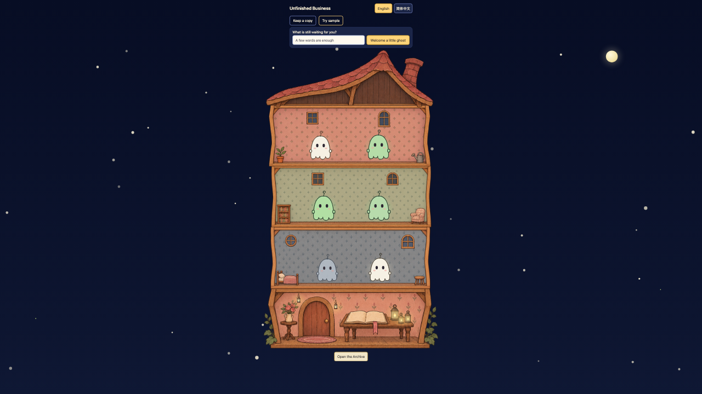
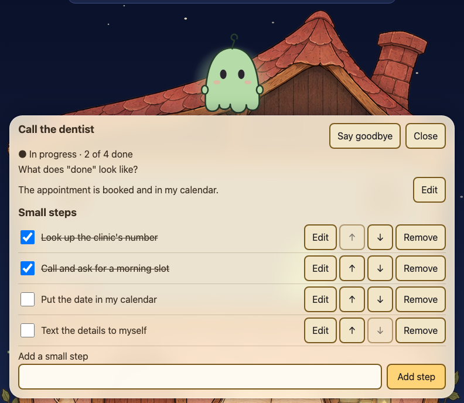
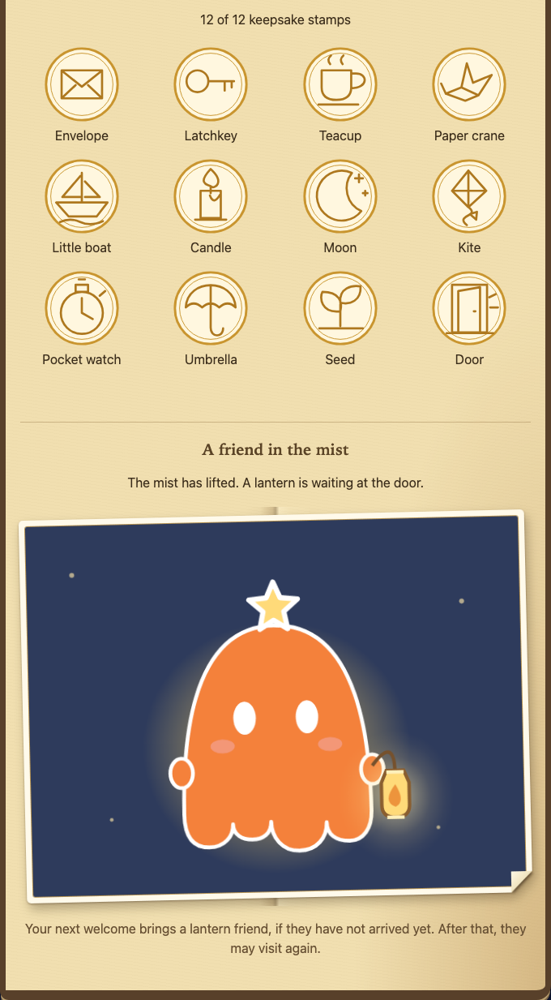
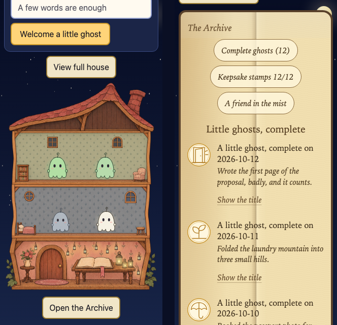
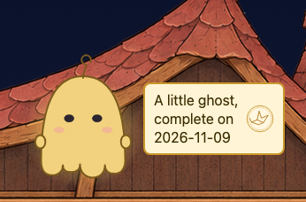

# Unfinished Business

A small, quiet web toy for the things you have not finished yet. Every unfinished task moves into an old dollhouse as a little ghost. Make the task clear, break it into small steps, tick them off, and the ghost slowly becomes real. When you confirm it is done, it stamps your memorial book and flies in, and a warm lamp lights up in the lobby.

English and 简体中文 are both built in. Everything stays in your browser: no account, no server, no analytics and no external network requests (the page and its own images load from the same origin as the page itself).



*The whole old house at night, from the roof to the lobby with its door and book. Six ghosts live on three floors: grey ones are not clear yet, white ones are ready to start, green ones are in progress. Five warm lamps are lit.*



*One unfinished thing: what "done" looks like, and four small steps, half of them ticked.*



*The memorial book after twelve confirmations: all twelve keepsake stamps, and the lantern ghost revealed on a paper sticker.*



*On a phone (320px wide) the house focuses on one floor at a time. Left: the house. Right: the memorial book.*

## What it does

- **A ghost for every task.** Up to ten ghosts live in the house (two per floor). The house grows a floor when the third, fifth, seventh and ninth ghost moves in. Ghost shape and the old-house scenery never change; only the ghost's colour and glow do.
- **Four looks, no scores.** Grey: not clear yet (it needs a "what does done look like?" sentence and a first small step). White: ready to start. Green: in progress, getting more colourful with every step. Ready to confirm: every step is ticked. Gold only appears after you confirm. There are no streaks, deadlines or countdowns.
- **Small steps do small chores.** Ticking the first, second and third step makes the ghost sweep, water the plants and wipe the window. Unticking a step makes it erase the last bit and the progress honestly steps back.
- **Confirm by hand.** Nothing is ever completed automatically. Confirming asks for an optional short note, then the ghost is stamped into the memorial book.
- **Memorial book and warm lamps.** Titles are hidden in the book by default; you can show or hide each one. Each confirmed ghost lights one of twelve warm lamps in the lobby. Moving a ghost out quietly (deleting it) leaves no memorial and does not light a lamp. Each memorial is a compact row with a small seal; a long note shows two lines with a Read more button, and three buttons at the top of the book jump to the entries, the keepsake stamps and the friend in the mist.
- **Keepsake collection.** The twelve stamps you earn form a small collection, and a picture of a ghost is gradually revealed. After the twelfth, the next ghost to move in carries a lantern (once guaranteed, then now and then by chance).
- **Try sample.** A sandbox ghost shows how everything works; it never touches your real notebook.
- **Accessible and calm.** Keyboard operable, landmarks and polite live announcements, 44px touch targets, 16px minimum text, and a real "reduce motion" mode that follows your system setting.



*With the system "reduce motion" setting on, the celebration becomes a still page: the same sentence and the same stamp, shown at once. A short text line also repeats what a screen reader announces.*

## Install, run and test

You need a current Node.js (this project is developed on Node 26) and npm.

```sh
npm install
npm run dev            # development server with hot reload
npm run build          # type-check (tsc --noEmit) and build to dist/
npm run preview        # serve the production build locally
```

```sh
npm test                   # Vitest: unit, property-based (fast-check), component and source/build-safety tests
npm run test:e2e:install   # first time only: downloads Chromium for Playwright
npm run test:e2e           # builds, starts a preview server and runs the browser tests (Chromium only)
```

Tips: the browser tests are thorough and take a while; `npm run test:e2e -- --workers=1` runs them one at a time and is gentler on a laptop. `npm test -- --maxWorkers=1` does the same for Vitest. `npm run release:check` runs the pre-publication checks described below.

The property tests cover the 27 correctness properties written in `.kiro/specs/unfinished-business/design.md`; `tests/property-coverage.test.ts` checks that each has a labelled test with at least 100 runs.

## Deploying (static hosting, including a sub-path)

`npm run build` produces a self-contained `dist/` folder of HTML, CSS, JavaScript and images. Asset URLs are relative (`base: './'`) and navigation uses the URL hash (`#/archive`), so there is nothing to configure:

- **Any static host or folder.** Upload `dist/` anywhere, at the root or inside a sub-folder. No server-side routing or rewrite rules are needed.
- **GitHub Pages (project site).** Publish the contents of `dist/` as the Pages site. It works under `https://<user>.github.io/<repo>/` because nothing is root-absolute. The browser tests run the main flow both at `/` and under `/unfinished-business/` to check this.
- **No external requests.** The browser tests record network requests and fail on any other origin. The production bundle is scanned for external addresses, development markers, HTML-writing calls and service-worker registration (`tests/dist.test.ts`).

## Offline

There is no service worker. After the first screen is drawn, the page quietly preloads the images for floors that have not grown yet, using the same `srcset` and `sizes` as the real images. Once that has finished (the house element reports `data-floor-preload="ready"`), you can go offline and keep playing in the same tab, including growing new floors. Boundaries:

- It works for the page that is already open. Opening the site fresh while offline is not supported.
- Only the image candidate for the current window width and pixel density is preloaded. If you cross a width or pixel-density breakpoint after going offline, a floor that has not been fetched yet shows a plain placeholder instead of its picture (the ghosts still work).
- Clearing the browser cache while offline can remove what was preloaded.

## Your data

Everything lives in your browser's `localStorage`: `ub:save` holds the notebook (JSON, `schema_version` 1). If the saved text cannot be read, the app does not guess: it opens a recovery screen with three choices (keep a copy of the old text, carry on with a blank page without saving, or back the old text up under a new `ub:backup:N` key and start fresh). The old text is never overwritten until a verified backup exists.

- **Keep a copy** (top of the page) downloads `unfinished-business-<date>.json` with all your words: titles, steps, notes and the memorial book. There is no import feature.
- **Private by default.** Titles are hidden in the memorial book unless you choose to show them. Anyone with access to the same browser profile can read the saved notebook, so use a private profile on shared computers.
- **Failing storage.** If the browser refuses to save (private mode, full storage), the app keeps working in memory, says so gently, and makes the export button prominent.

## Original ghost, scenery and licences

The ghost, the night sky, the warm lamps, the keepsake stamps and the celebration are drawn in code with SVG and CSS. The old-house scenery (roof, lobby, five floor modules and the lantern component) consists of image files, described in [`ASSETS.md`](ASSETS.md) together with the data files that go with them.

The code is released under the [MIT License](LICENSE). That licence covers the source code; see `ASSETS.md` for the status of the scenery images.

Dependencies:

| Package | Version | Licence | Where it is used |
|---|---|---|---|
| preact | 11.2.0 | MIT | the only runtime dependency, bundled into `dist/` |
| vite, @preact/preset-vite | 8.3.6, 2.10.6 | MIT | build |
| typescript | 7.0.2 | Apache-2.0 | type checking |
| vitest, @testing-library/preact, happy-dom, fast-check | 5.1.0, 3.2.6, 21.0.4, 4.10.2 | MIT | unit, component and property tests |
| @playwright/test | 1.65.0 | Apache-2.0 | browser tests |

The runtime code in `dist/` is MIT-licensed (preact and this project's own code); the scenery images are described separately in [`ASSETS.md`](ASSETS.md). `npm run release:check` also lists every transitive dependency's licence. Two build-time-only transitive packages are outside the MIT/ISC/Apache/BSD set: `lightningcss` (MPL-2.0, used by the build tool Vite) and `caniuse-lite` (CC-BY-4.0, browser-support data). Neither is included in `dist/` or in this repository, and `npm run release:check` lists them separately as unpublished build-time dependencies.

## Regenerating the screenshots

The README pictures come from isolated, disposable browser contexts with made-up notebooks (`e2e/readme-screenshots.spec.ts`). The first picture needs the whole four-floor house in one frame, which does not fit a 1:1 1280×720 window, so it is captured from a 3200×3300 viewport, cropped to the top 3200×1800 and scaled by 0.4 to 1280×720 (a taller viewport moves the background stars off the transparent "Try sample" button). The product's styles and layout are untouched. To regenerate them:

```sh
SHOTS_DIR=/some/scratch/folder npx playwright test e2e/readme-screenshots.spec.ts --project=chromium --workers=1
```

It also writes one comparison picture (`archive-entries-en.png`) that the README does not use; copy only the five pictures the README shows into `docs/screenshots/`.

## 简介

「小幽灵的未完成事项」：把没做完的事变成住在旧宅里的小幽灵。写清楚“做到什么算完成”、拆成几个小步骤、一步步勾选，小幽灵会慢慢变得有颜色；你亲手确认完成后，它会盖章飞进纪念册，门厅里点亮一盏暖灯。界面内置英文和简体中文，所有内容只保存在你自己的浏览器里，没有账号、没有服务器、没有任何外部请求。

运行：`npm install`，然后 `npm run dev`；测试：`npm test`，浏览器测试先 `npm run test:e2e:install` 再 `npm run test:e2e`；构建：`npm run build`，把 `dist/` 放到任何静态空间（根目录或子路径都可以，包括 GitHub Pages 的项目页）。「留一份副本」会下载包含你全部文字的 JSON；没有导入功能。代码为 MIT 许可。
